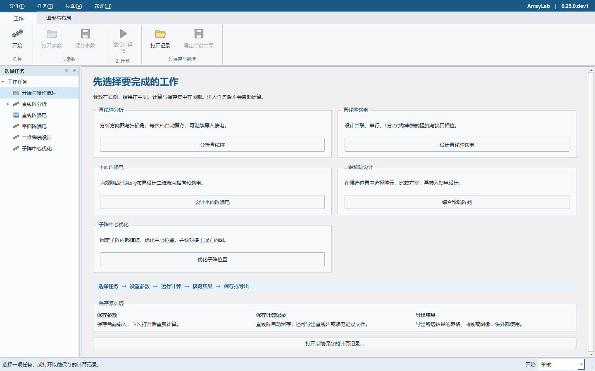
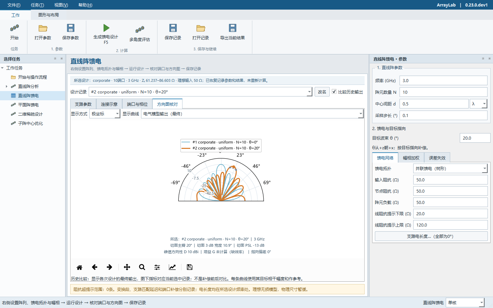
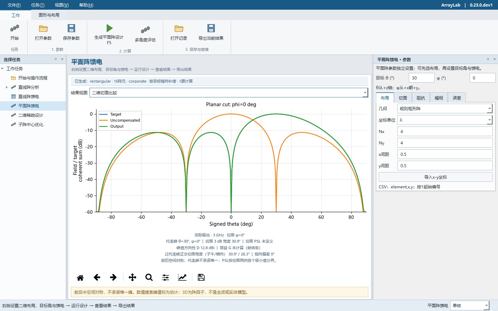
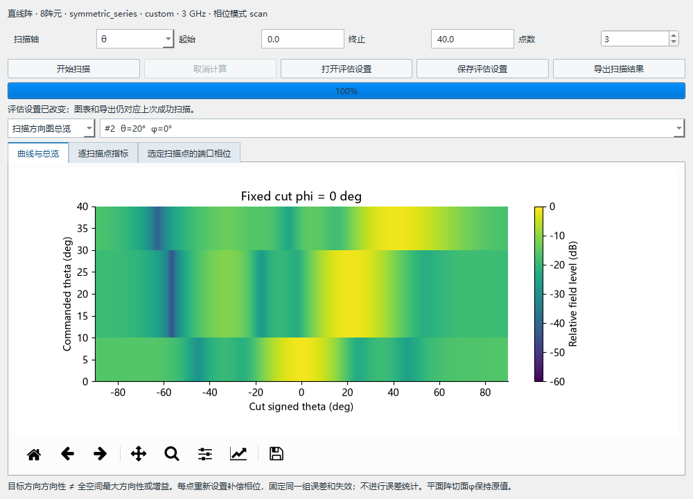
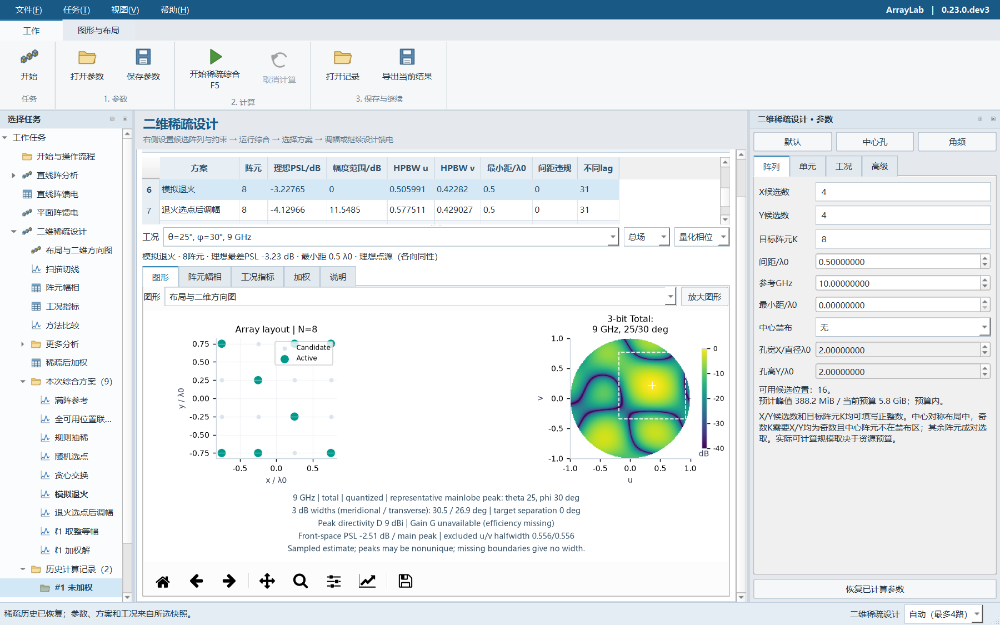

# ArrayLab 阵列分析

用于直线阵、平面阵及理想馈电网络电气分析的开源Python工具，提供Qt桌面工作台与无头命令行。当前源码为0.23.0.dev1，正式Release保留0.22.1，原创源码采用MIT许可。[下载正式版](https://github.com/KaysinBIT/arraylab/releases/tag/v0.22.1) · [发行说明](docs/releases/0.22.1.md)。

**0.23.0.dev1 馈电曲线显示**：“显示曲线”现在同时控制二维、极坐标和三维图，默认单独显示最终输出。需要同时查看目标、未补偿和最终三条曲线时，显式选择“补偿前后对比”。修复选择最终输出却仍自动叠画未补偿偏转曲线的问题，电气计算不变。

**0.23.0.dev0 直线阵操作流程**：每次成功F5自动保存到“历史计算记录”，重启后恢复；“叠加比较”只控制绘图，不再删除旧记录。选中一条已计算阵列后，点击顶部“将该阵列导入馈电设计”，按所选快照恢复阵列和扫描角，建立均匀幅度、连续扫描补偿的馈电输入，再按F5生成。不会把尚未计算的输入或旧馈电附加相位混入原阵列。本功能尚未进入0.22.1正式下载包。

操作及指向核算见[直线阵到馈电设计](docs/linear-feed-handoff.md)。

**0.22.1 正式版**采用金色天线阵列与青色波束的新图标，窗口和Windows程序文件保持一致。顶部功能区按文字高度排布；开始页、参数区与结果区在小窗口可滚动查看，方向图保留可读尺寸，多图比较自适应换行。馈电页“设计记录”支持同项重选，并恢复完整参数和结果；空列表有明确提示。顶部“打开记录”也支持导出的完整`feed-network.json`，恢复原设计结果而不重新计算。

**0.22.0 正式版**加入[逐支路匹配延迟](docs/branch-electrical-lengths.md)与[自定义稀疏网格及K](docs/sparse-arrays.md)，改善稀疏综合的进度、取消和资源保护，并提升[三维图旋转/缩放响应](docs/3d-interaction.md)。串馈末级连接图现在清楚显示沿主干延续到最后负载。

保留0.21.0的线阵三维方向图、图下主要指标及固定内部模板的连续子阵中心优化。[方向图与指标](docs/pattern-metrics.md) · [子阵中心优化](docs/subarray-centers.md)。

本版按操作顺序组织界面：启动先选任务，右侧设置当前任务的参数，中间核对结果，顶部完成计算、保存和导出。直线阵分析、直线阵馈电、平面阵馈电、二维稀疏设计、子阵中心优化各有独立入口，进入任务不会自动计算。首次使用请从[五步快速上手](docs/quickstart.md)开始。

直线阵与直线阵馈电现在支持保存并重新打开完整计算记录，恢复曲线、标签、选中项及已有结果，不重新计算；也能打开旧版馈电比较文件。保存参数、保存记录、导出结果各有明确入口，详见[计算记录与文件选择](docs/calculation-history.md)。平面阵、二维稀疏设计和子阵中心优化尚不支持这项完整多次历史恢复。

原有有界多核及无头功能保留：扫描点、平面阵三组方向图、稀疏方案复核可并行。右下角可选自动（最多4路）、单核或2–8路；小任务自动串行。无头使用`--workers`，详见[多核范围与资源控制](docs/multicore.md)。物理尺寸和误差统计继续暂缓。



[快速上手](docs/quickstart.md) · [计算记录](docs/calculation-history.md) · [任务计划状态](ROADMAP.md) · [电气设计](docs/electrical-design.md) · [扫描评估](docs/scan-study.md) · [二维稀疏](docs/sparse-arrays.md) · [平面阵](docs/planar-arrays.md) · [验证记录](docs/validation.md) · [参与开发](CONTRIBUTING.md)

功能分析参考PCAAD说明书，参考PDF不随仓库分发；界面风格参考[CST官方设计环境说明](https://www.3ds.com/products/simulia/cst-studio-suite/electromagnetic-design-environment)及[官方宣传册第3页](https://www.3ds.com/assets/invest/2024-03/simulia-cst-studio-suite-brochure.pdf)。本项目为独立实现。

## 启动

Windows用户可从[GitHub Release](https://github.com/KaysinBIT/arraylab/releases/tag/v0.22.1)下载`ArrayLab-0.22.1-windows-x64.zip`，完整解压后运行`ArrayLab.exe`，无需安装Python；脚本使用同目录的`ArrayLab-cli.exe`。移动时保留整个目录及`_internal`。

源码用户可在Windows PowerShell中创建环境并启动桌面版：

```powershell
git clone https://github.com/KaysinBIT/arraylab.git
cd arraylab
python -m venv .venv
.\.venv\Scripts\python.exe -m pip install ".[desktop]" pytest
.\.venv\Scripts\python.exe -m arraylab
```

已记录的本地构建环境为Python 3.14.2 x64；`requirements-lock.txt`保留其依赖版本。其他版本的兼容性以对应测试结果为准。

当前源码构建后的桌面入口为`dist/ArrayLab-0.23.0.dev1/ArrayLab.exe`，无头入口为同目录的`ArrayLab-cli.exe`。项目根目录的“启动 ArrayLab.cmd”也指向本版。具体系统和验证边界见[验证记录](docs/validation.md)。

## 无头运行

从源码运行（已按上节安装依赖）：

```powershell
.\.venv\Scripts\python.exe -m arraylab --headless --elements 20 --frequency-ghz 3 --spacing 0.5 --scan-deg 30 --output-dir ".\results\run01" --plot both
```

构建运行包后的等价入口：

```powershell
.\dist\ArrayLab-0.23.0.dev1\ArrayLab-cli.exe --elements 20 --scan-deg 30 --output-dir ".\results\run02" --plot both
```

也可运行`python -m arraylab.cli`或安装后的`arraylab-cli`。独立命令行EXE的启动逻辑不包含Qt；源码无头路径在导入任何Qt模块前分派。无需显示器、桌面会话或`QT_QPA_PLATFORM=offscreen`；不会打开图形窗口。当前实际测试环境仍为Windows，未声称完成Linux/macOS验收。

| 参数 | 作用 |
| --- | --- |
| `--elements` | 阵元数，默认8 |
| `--frequency-ghz` | 工作频率GHz，默认3 |
| `--spacing`、`--spacing-unit` | 间距及单位`lambda`或`mm`，默认0.5λ |
| `--scan-deg` | 扫描角，默认0° |
| `--step-deg` | 绘图/导出采样步长，默认0.1° |
| `--config` | UTF-8 JSON分析方案，例如`examples/analysis.json`；兼容旧版`examples/ula.json`，显式命令行参数覆盖文件值 |
| `--output-dir` | 创建一个新结果目录；已有目录（包括空目录）不覆盖，退出码3 |
| `--include-phase` | DAT文件增加相位列 |
| `--plot` | `none`、`rectangular`、`polar`、`both`、`3d`或`all`，默认none；需要同时指定输出目录；支持3d/all |
| `--help`、`--version` | 查看帮助或版本，不启动界面 |
| `--workers` | 0自动、1单路、2–8指定上限；用于扫描、平面阵方向图及稀疏复核；普通直线阵计算仍串行 |

不指定输出目录时，只向标准输出写一行JSON指标。指定目录时生成：

- `summary.json`：参数、模型/坐标约定、方向性、主瓣指向、HPBW、采样数、提示信息和输出文件名。
- `pattern.dat`：角度°、幅度dB、可选相位°，可在桌面版直接读入。
- `excitation.csv`：阵元编号、x坐标mm、相对幅度、激励相位°。
- `sphere-pattern.csv`：额外输出完整球面方向图，默认2°显示网格；该采样不代替指标搜索。
- `rectangular.png`和/或`polar.png`：按需生成，使用无交互Agg渲染；显示下限−40 dB不影响数据文件。图中文字使用通用英文字体，避免依赖系统中文字体。

结果先在临时目录内全部生成，成功后再发布为目标目录。不要让多项任务共用一个输出目录；批处理脚本为每次调用分配不同路径即可。配置文件的格式及6项参数见[分析方案约定](docs/analysis-format.md)；未知字段、重复字段、错误类型、未知版本和非有限数值会被拒绝。

成功退出码为0，参数/配置内容错误为2，文件读写错误为3，其他运行异常为1。失败时错误JSON写入标准错误，标准输出不混入成功信息；`--help`和`--version`输出普通文本。无唯一主瓣或无完整半功率宽度时，相关字段为JSON的`null`，仍属正常计算结果。

GUI入口也支持`ArrayLab.exe --headless --output-dir ...`，但Windows窗口版EXE不保证标准输出/错误流可用。脚本、重定向和调度任务应使用`ArrayLab-cli.exe`。

仅安装源码计算功能可使用`pip install .`，基础依赖为NumPy、SciPy及threadpoolctl；导出PNG另安装`pip install ".[plotting]"`；桌面功能安装`pip install ".[desktop]"`。完整锁定清单包含本次构建与测试工具，并非无头计算的最小依赖清单。

## 使用

先在开始页选择一项任务，也可使用左侧“选择任务”或顶部“任务”菜单切换。

| 想完成的工作 | 选择任务 | 主要核对内容 |
| --- | --- | --- |
| 查看均匀直线阵的扫描与方向图 | 直线阵分析 | 方向图、阵元激励、方向性和半功率宽度 |
| 设计直线阵的功分网络及端口补偿 | 直线阵馈电 | 支路阻抗、连接图、端口幅相和输出方向图 |
| 为矩形或任意x-y布局设计馈电 | 平面阵馈电 | 布局、目标θ/φ、切面、三维阵因子与端口表 |
| 从候选位置选择阵元并比较方案 | 二维稀疏设计 | 约束、布局、加权与工况；可继续转入平面阵馈电 |
| 保留内部模板，优化多个子阵的位置 | 子阵中心优化 | 子阵数量、内部模板、总孔径、最小阵元距、多角度/频率与主瓣排除区 |

1. **选择任务。** 进入后先查看页面标题下的操作提示；此时不会自动计算。
2. **设置参数。** 在右侧输入，或从“工作 → 打开参数”载入当前任务的参数文件。直线阵分析与直线阵馈电共用直线阵几何输入；平面阵参数独立。
3. **运行计算。** 在“工作”页点击当前任务的运行按钮，或按F5。按钮会显示“计算直线阵”“生成馈电设计”“生成平面阵设计”或“开始稀疏综合”。
4. **核对结果。** 在中间切换图形和表格；馈电任务核对自己的电气结果。修改输入后，已有图形、指标与导出仍属于上次计算，需再次运行才会更新。
5. **保存或导出。** 下次改参数重算选“保存参数”；下次接着看已有直线阵/馈电结果选“保存记录”；交给其他软件使用选“导出当前结果”。直线阵任务的导出按钮显示“导出所选曲线”。

“图形与布局”集中提供当前图形的保存、复制和重置；“模型视图”用于直线阵示意。菜单和快捷键跟随当前任务。消息窗口默认收起，可在“视图 → 消息”打开；面板位置乱了，可用“视图 → 恢复工作布局”。按F1查看当前任务说明，Ctrl+Home返回开始页。

直线阵每次成功F5都自动保留。勾选“叠加比较（最多5条）”可同时显示所选结果及最近几条；关闭比较不会删除历史。选中已计算结果后，可用顶部“将该阵列导入馈电设计”继续。导入外部曲线使用“文件 → 读入外部曲线（直线阵）”。两个具体参数例子见[快速上手](docs/quickstart.md)。

## 保存参数、计算记录与导出结果

| 操作 | 保存内容 | 重新打开后的用途 |
| --- | --- | --- |
| 保存参数（Ctrl+Shift+S） | 当前任务的有效输入，包括尚未计算的修改 | 打开参数（Ctrl+Shift+O）后检查输入，按F5重算 |
| 保存记录（Ctrl+S） | 导出直线阵已有历史，或馈电最近5项设计、标签及选中项 | 打开记录（Ctrl+O）不重算；直线阵追加到历史，馈电恢复设计列表 |
| 导出当前结果（Ctrl+E） | 当前所选结果的数据或报告，文件种类随任务变化 | 供外部查看、绘图或后续处理 |

计算记录不包含尚未计算的输入，也不是包含全部任务与窗口布局的完整项目文件。平面阵和二维稀疏仍使用各自的参数保存及结果导出。恢复范围、64 MiB文件上限与旧馈电比较文件兼容说明见[计算记录指南](docs/calculation-history.md)。

直线阵参数文件包含阵元数、频率、间距、间距单位、扫描角和采样步长，不含结果曲线或导入数据。打开参数不会自动计算或清除已有曲线。旧版平铺参数JSON可直接打开，新保存统一使用版本1格式。

桌面保存的直线阵参数JSON可直接用于无头计算，也可显式覆盖其中的参数；计算记录文件不作为`--config`输入：

```powershell
python -m arraylab --headless --config "examples/analysis.json" --scan-deg 30 --output-dir "results/scheme01"
```

覆盖仅作用于本次运行，不改动方案文件。详见[完整格式、兼容策略与失败行为](docs/analysis-format.md)。

## 馈电网络电气设计

从开始页“设计直线阵馈电”、“任务 → 直线阵馈电”或F6进入。在右侧依次设置直线阵几何、目标角及馈电参数。支持并联树形、串行逐级抽头、1分2后对称串馈，按目标幅度平方分配功率，计算各支路阻抗及λ/4变换线特性阻抗。输入端、内部节点和阵元负载默认50 Ω，均可编辑。



8路、各参考阻抗均50 Ω时，并联二等分变换线为70.710678 Ω；串行首级抽头为141.421356 Ω、续传支路为53.452248 Ω。超出用户所设提示范围的线段会突出显示。端口页另列未经补偿的路径相位。

新增对称串馈先将输入等分到左右两臂，再从中心向外抽头，仅支持偶数阵元。8路、各参考阻抗50 Ω时，首级等分线为70.710678 Ω，每臂首级抽头线100 Ω、续传线57.735027 Ω。左右镜像端口相位相同，不代表全部端口已等相。

在右侧“幅相加权”选择扫描/正侧向补偿及均匀、Chebyshev、Taylor或自定义CSV；在“误差失效”设置量化位数、幅相误差、随机种子和失效端口。“方向图核对”并列目标、未经补偿和模型输出，使用相同参考幅度。

在右侧“目标波束θ”输入−90°至90°的角度，并在“幅相加权”中选择“按目标指向补偿”，再点击顶部“生成馈电设计”或按F5。运行保留所选相位模式；仅修改目标角不会自动启用补偿。方向图上方分别列有效目标、输出切面峰及单峰偏差；多峰或无定义时不报告唯一指向。无头入口保持不变：

```powershell
python -m arraylab --headless --elements 8 --scan-deg -24 --feed-network symmetric_series --feed-phase scan --output-dir results/beam-line --plot both
python -m arraylab --headless --planar --nx 4 --ny 4 --scan-theta 35 --scan-phi 60 --feed-phase scan --output-dir results/beam-planar --plot all
```

支持参数保存/加载、完整计算记录恢复、DAT/JSON/CSV/SVG及无头PNG导出，保留最近5项可命名、可比较的设计记录。修改输入不改变已有快照。当前为中心频点、纯电阻、无损T型网络与理想匹配相移；实际隔离、器件损耗、基板和物理尺寸未设计。馈电任务只显示馈电结果，均匀直线阵指标在“直线阵分析”中查看。详见[电气设计范围和输入格式](docs/electrical-design.md)。

```powershell
python -m arraylab --headless --elements 8 --feed-network corporate --output-dir results/feed-parallel
python -m arraylab --headless --feed-config examples/feed-series.json --output-dir results/feed-series
python -m arraylab --headless --feed-network symmetric_series --elements 8 --output-dir results/feed-symmetric
```

`--feed-input-ohm`、`--feed-junction-ohm`和`--feed-load-ohm`设置阻抗；`--feed-min-line-ohm`与`--feed-max-line-ohm`设置提示范围。`--feed-config`与原有`--config`互斥。详见[阻抗公式与拓扑](docs/feed-impedance.md)及[电气模式、CSV与兼容约定](docs/electrical-design.md)。

## 规则与任意坐标平面阵

从开始页“设计平面阵馈电”、“任务 → 平面阵馈电”或F7进入，右侧切换为独立的平面阵参数。支持规则Nx×Ny阵及`element,x,y`坐标CSV，最多200阵元、最大两阵元距离40λ。可查看坐标、二维切面、上半球图、端口/阻抗表及可鼠标旋转的全空间三维方向图。

右侧设置目标θ（0–90°）和φ（−180–180°），在“幅相”中选择“按目标指向补偿”，再点击顶部“生成平面阵设计”或按F5。结果区同时显示目标、输出代表峰与球面角距；角距不代表唯一波束误差。切面φ在“切面”中独立设置，天顶φ及无定义峰值显示“未定义”。



```powershell
python -m arraylab --headless --planar-config examples/planar-rectangular.json --output-dir results/planar --plot all
python -m arraylab --headless --planar --coordinates examples/planar-coordinates.csv --scan-theta 33 --scan-phi 47 --cut-phi 47 --output-dir results/arbitrary --plot all
```

扫描θ从+z轴量起，φ从+x朝+y；三维图为各向同性点源阵因子，前后半空间对称，不是全波或实体模型。方向性按全空间积分，非相干峰使用数值搜索并标记估计性质，不承诺唯一主瓣。[平面阵范围、角度及导出说明](docs/planar-arrays.md)。

## 多扫描角电气评估



在直线阵馈电或平面阵馈电任务生成设计后，点击顶部“多角度评估”，使用所选已生成设计创建扫描。支持直线阵θ扫描、平面阵θ或φ扫描，提供目标方向响应、方向图总览、逐点方向图和端口补偿相位。同一设计的扫描窗口关闭后再次打开，会保留本次会话的设置和结果；关闭主程序后的恢复不在此范围内。可保存设置、取消计算及导出DAT/CSV/JSON/PNG；无头入口为`--study scan`或`--study-config`。

```powershell
python -m arraylab --headless --study-config examples/scan-linear.json --output-dir results/scan --plot all
```

每点更新理想补偿相位，保持阻抗主干及同一组阵元误差不变。指标是指定目标方向的方向性，不是峰值方向性或增益。误差统计与物理尺寸按用户要求继续暂缓。[操作、坐标、复算和完整边界](docs/scan-study.md)。

## 二维稀疏阵列



从开始页“综合稀疏阵列”、“任务 → 二维稀疏设计”或F8进入：右侧设置参数，顶部“开始稀疏综合”或F5运行，中央选择方案、图形和幅相表；运行消息可从“视图 → 消息”打开。支持规则/随机对称抽稀、贪心交换、模拟退火、重加权ℓ1、中心禁布区、最小中心距及同一布局的minimax/Taylor/Chebyshev/Gaussian加权。保留多角度/多频率共同综合、标量单元模型、相位量化复核及完整离线报告。

选择方案和工况后，可将理想布局与相对幅度送入平面阵电气页，载入毫米坐标、频率和扫描角，并从可编辑的50 Ω并联网络初值继续设计。仅兼容各向同性、最多200阵元及电气页孔径/幅度范围的方案；不截断阵元或静默替换单元模型。原相位量化码不迁移，新网络重新设计补偿相位。

```powershell
python -m arraylab --headless --sparse run --config examples/sparse-basic.json --output results/sparse01 --report
python -m arraylab --headless --sparse inspect --input results/sparse01
python -m arraylab --headless --sparse planar --input results/sparse01 --index 3 --case-index 0 --output results/handoff01
```

行索引从0开始，先inspect查看当前方案。稀疏候选网格及目标K可自定义正整数，实际计算受中心对称、可用位置和资源预算约束；输出协议、全部入口和模型边界见[操作指南](docs/sparse-arrays.md)。运行包及源码自包含，不依赖原`sparse2d_demo`目录。误差统计与馈线物理尺寸仍暂缓。

## 首版范围与坐标

- 直线阵分析保留均匀阵基准；馈电任务支持幅相加权，平面阵任务支持二维坐标。这三项电气分析采用各向同性点源、无互耦、无地平面，最多200阵元。
- 阵列沿x轴，阵列中心为相位参考。显示x-z前半空间切面，θ从+z朝+x为正，显示范围−90°至90°。
- 各向同性直线阵在三维空间绕x轴旋转对称，图中的单个峰不意味着三维只有一个笔形波束；前后半空间具有对应辐射。
- 方向性D使用全空间总辐射功率，不是二维切面积分，也不等于包含损耗的增益。
- 功率峰值一半的边界用于计算HPBW，对应−3.0103 dB。多等高主瓣、全向单元或边界未落在所示范围内时不报告唯一宽度。
- 主瓣与宽度不依赖绘图采样步长。绘图过粗时提示减小步长；不会用粗采样的最大值假装真实主瓣峰值。
- 新软件首版输入范围：0.001–1000 GHz，间距0.000001–10λ，绘图步长0.01°–5°。除200阵元外，这些范围为本版约束，不是原软件承诺。
- 方向图按理论峰值归一化0 dB；保存数值零点以−300 dB表示。该数值只是有限精度下限，零点的相位不作物理解释。显示下限不改变保存的数据。
- 导入文件只显示数据，不由单个切面反推方向性，也不假定其角度定义与当前模型相同。允许的导入角度范围为−180°至180°，角度必须严格递增。

尚未实现或暂缓：物理馈线尺寸、电气馈电模型中的非各向同性/极化单元、互耦、独立阵元连续坐标自动优化、复阻抗匹配与全波求解、蒙特卡洛统计平均、包含窗口布局的完整项目持久化。稀疏模块的标量单元响应和子阵中心连续优化属于已有独立功能。

## 计算与核对

对阵元坐标xₙ与扫描方向u₀=sinθ₀，归一化场为各复指数项之和除以N。首版对均匀阵使用有限几何级数及可去奇点的解析极限；总功率使用球面积分的解析结果。数值测试采用独立逐阵元复数求和和SciPy自适应积分交叉检查。

参考：用户提供说明书IV.D.1，p.45–49；[MathWorks的方向图和方向性定义](https://www.mathworks.com/help/phased/ug/element-and-array-radiation-patterns-and-responses.html)。工具嵌入参考[Matplotlib Qt后端文档](https://matplotlib.org/stable/api/backend_qt_api.html)。外部文档仅用于实现核对，不用于扩大原软件功能范围。

## 测试与构建

- 使用上节的虚拟环境；以下命令中的`python`可替换为`.\.venv\Scripts\python.exe`。
- 数值与文件测试：`python -m pytest`
- Qt交互集成检查：`python -m arraylab --smoke-test tmp/qt-smoke`
- Windows构建依赖：`python -m pip install ".[desktop]" pyinstaller`
- Windows独立运行包构建：`python tools/build_release.py`
- 运行包检查：`dist/ArrayLab-0.23.0.dev1/ArrayLab.exe --smoke-test tmp/frozen-smoke`
- 便携包与源码包：`python tools/package_release.py`（先完成运行包构建）。

检查报告区分数学测试、Qt自动交互、真实桌面操作和打包运行结果。打包运行通过不自动证明在未安装Python的另一台干净电脑上通过。

GitHub Actions仅保留手动触发入口，推送和拉取请求不会自动运行测试。本轮验证均安排在推送前，推送后不再测试。手动工作流覆盖Windows/Linux上的数值、文件与无头测试，不替代桌面视觉验收。下一步开发按[ROADMAP](ROADMAP.md)推进。

## 许可

原创项目文件使用MIT许可，见`LICENSE`。第三方依赖及参考说明书不受该MIT许可重新授权，详见`THIRD_PARTY_NOTICES.md`。
