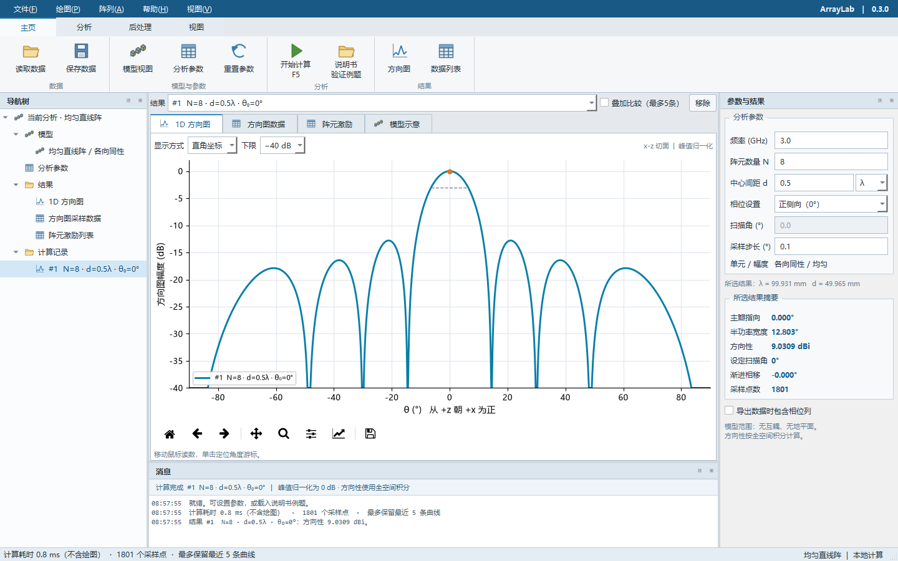
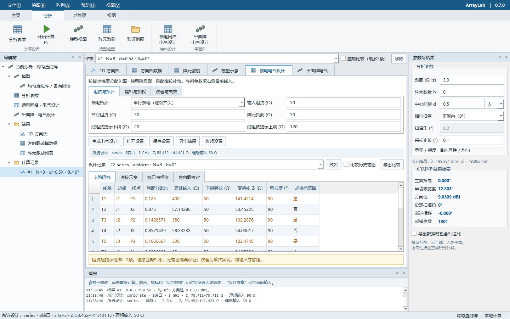
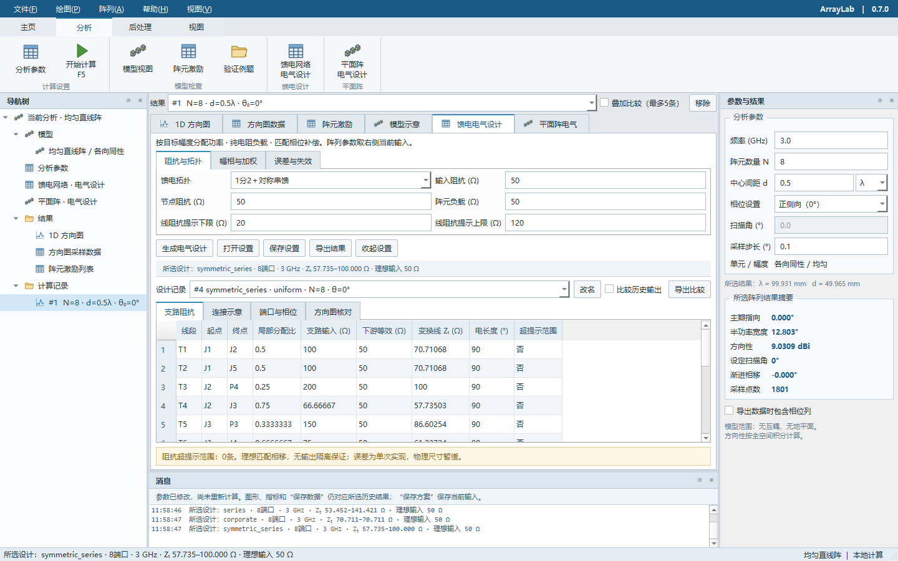
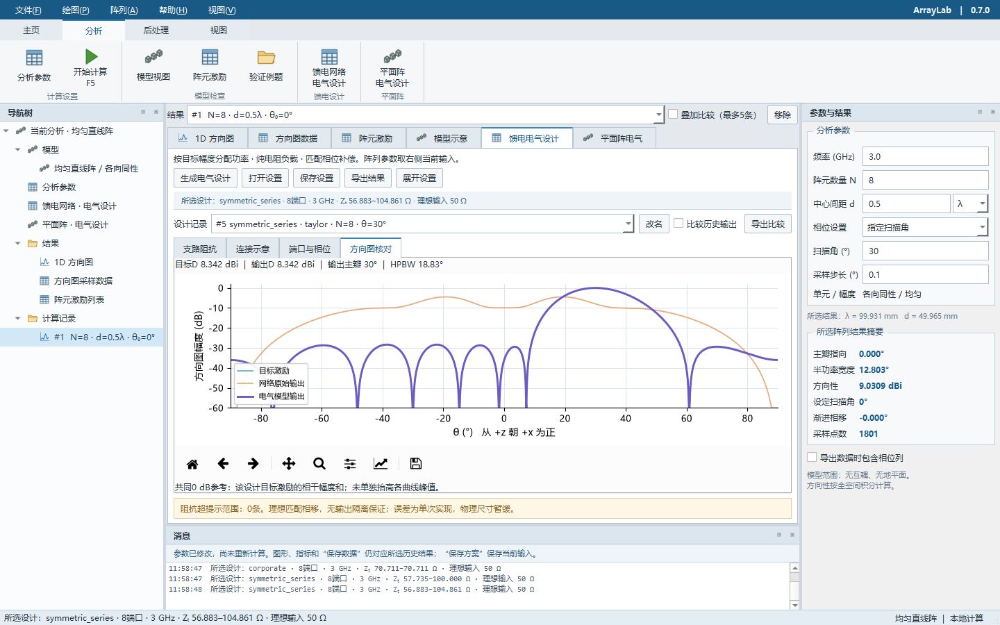
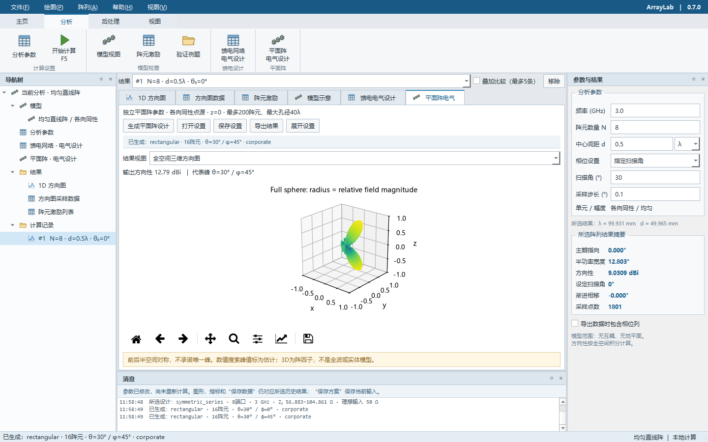

# ArrayLab 阵列分析

用于直线阵、平面阵及理想馈电网络电气分析的开源Python工具，提供Qt桌面工作台与无头命令行。当前版本0.10.0，原创源码采用MIT许可。

桌面采用参考CST的工程工作台布局：顶部功能区、左侧导航树、中央模型与结果视图、右侧参数与指标、底部消息窗口。图标和模型示意独立绘制。0.7.0完成相位补偿、幅度加权、自定义激励、误差/失效/量化分析和设计比较，并加入规则矩形及任意坐标平面阵、二维切面与可旋转三维阵因子。0.7.1补齐馈电及平面阵切面DAT导出；0.8.0新增多扫描角电气评估、逐点相位表、扫描方向图总览和可取消的后台计算。0.9.0合并二维稀疏选点、禁布/间距约束、稀疏后加权、角频联合综合和量化复核，并连接到平面阵电气设计。0.10.0将稀疏界面重做为主工作台内置页面，删除原独立稀疏窗口代码。物理尺寸设计按用户要求暂缓。



[任务计划状态](ROADMAP.md) · [电气设计](docs/electrical-design.md) · [扫描评估](docs/scan-study.md) · [二维稀疏](docs/sparse-arrays.md) · [平面阵](docs/planar-arrays.md) · [验证记录](docs/validation.md) · [参与开发](CONTRIBUTING.md)

功能分析参考PCAAD说明书，参考PDF不随仓库分发；界面风格参考[CST官方设计环境说明](https://www.3ds.com/products/simulia/cst-studio-suite/electromagnetic-design-environment)及[官方宣传册第3页](https://www.3ds.com/assets/invest/2024-03/simulia-cst-studio-suite-brochure.pdf)。本项目为独立实现。

## 启动

仓库提供源码，不包含预构建EXE。克隆后可在Windows PowerShell中创建环境并启动桌面版：

```powershell
git clone https://github.com/KaysinBIT/arraylab.git
cd arraylab
python -m venv .venv
.\.venv\Scripts\python.exe -m pip install ".[desktop]" pytest
.\.venv\Scripts\python.exe -m arraylab
```

已记录的本地构建环境为Python 3.14.2 x64；`requirements-lock.txt`保留其依赖版本。其他版本的兼容性以对应测试结果为准。

Windows运行包构建成功后，桌面入口为`dist/ArrayLab-0.10.0/ArrayLab.exe`，无头入口为同目录的`ArrayLab-cli.exe`。移动时须保留整个目录及`_internal`；运行包用户无需另装Python。本轮目标按用户确认采用现有Windows 10主机验收，具体系统和验证边界见[验证记录](docs/validation.md)。

## 无头运行

从源码运行（已按上节安装依赖）：

```powershell
.\.venv\Scripts\python.exe -m arraylab --headless --elements 20 --frequency-ghz 3 --spacing 0.5 --scan-deg 30 --output-dir ".\results\run01" --plot both
```

构建运行包后的等价入口：

```powershell
.\dist\ArrayLab-0.10.0\ArrayLab-cli.exe --elements 20 --scan-deg 30 --output-dir ".\results\run02" --plot both
```

也可运行`python -m arraylab.cli`或安装后的`arraylab-cli`。独立命令行EXE的启动逻辑不包含Qt；源码无头路径在导入任何Qt模块前分派。无需显示器、桌面会话或`QT_QPA_PLATFORM=offscreen`；不会打开图形窗口。当前实际测试环境仍为Windows，未声称完成Linux/macOS验收。

| 参数 | 作用 |
| --- | --- |
| `--elements` | 阵元数，默认8 |
| `--frequency-ghz` | 工作频率GHz，默认3 |
| `--spacing`、`--spacing-unit` | 间距及单位`lambda`或`mm`，默认0.5λ |
| `--scan-deg` | 扫描角，默认0° |
| `--step-deg` | 绘图/导出采样步长，默认0.1° |
| `--config` | UTF-8 JSON分析方案，例如`examples/analysis.json`；兼容旧版`examples/ula.json`，显式命令行参数覆盖文件值 |
| `--output-dir` | 创建一个新结果目录；已有目录（包括空目录）不覆盖，退出码3 |
| `--include-phase` | DAT文件增加相位列 |
| `--plot` | `none`、`rectangular`、`polar`或`both`，默认none；需要同时指定输出目录 |
| `--help`、`--version` | 查看帮助或版本，不启动界面 |

不指定输出目录时，只向标准输出写一行JSON指标。指定目录时生成：

- `summary.json`：参数、模型/坐标约定、方向性、主瓣指向、HPBW、采样数、提示信息和输出文件名。
- `pattern.dat`：角度°、幅度dB、可选相位°，可在桌面版直接读入。
- `excitation.csv`：阵元编号、x坐标mm、相对幅度、激励相位°。
- `rectangular.png`和/或`polar.png`：按需生成，使用无交互Agg渲染；显示下限−40 dB不影响数据文件。图中文字使用通用英文字体，避免依赖系统中文字体。

结果先在临时目录内全部生成，成功后再发布为目标目录。不要让多项任务共用一个输出目录；批处理脚本为每次调用分配不同路径即可。配置文件的格式及6项参数见[分析方案约定](docs/analysis-format.md)；未知字段、重复字段、错误类型、未知版本和非有限数值会被拒绝。

成功退出码为0，参数/配置内容错误为2，文件读写错误为3，其他运行异常为1。失败时错误JSON写入标准错误，标准输出不混入成功信息；`--help`和`--version`输出普通文本。无唯一主瓣或无完整半功率宽度时，相关字段为JSON的`null`，仍属正常计算结果。

GUI入口也支持`ArrayLab.exe --headless --output-dir ...`，但Windows窗口版EXE不保证标准输出/错误流可用。脚本、重定向和调度任务应使用`ArrayLab-cli.exe`。

仅安装源码计算功能可使用`pip install .`，基础依赖为NumPy和SciPy；导出PNG另安装`pip install ".[plotting]"`；桌面功能安装`pip install ".[desktop]"`。完整锁定清单包含本次构建与测试工具，并非无头计算的最小依赖清单。

## 使用

1. 在右侧参数面板输入频率GHz、阵元数、中心间距（λ或mm），设置正侧向或指定扫描角。
2. 在顶部“主页”点击“开始计算”，或按F5，查看方向图、主瓣指向、半功率波束宽度和方向性。
3. 选择直角坐标或极坐标。在图中移动鼠标读取幅度，点击定位游标；图下工具栏可缩放、平移及保存图片。
4. 勾选“叠加比较”后重算，可保留最新5条曲线。曲线下拉框选定指标和保存的对象。
5. “采样数据”显示方向图数值，“阵元激励”显示位置、单位幅度和馈电相位。
6. 功能区的“保存数据”导出所选曲线的无表头DAT文件；右侧可勾选相位列。“读取数据”可导入2/3列文件作对比。
7. “说明书验证例题”载入p.48的5阵元、0.4λ间距、60°扫描例题并计算。按F1可打开详细说明。
8. 左侧导航树可切换模型、数据及历史计算记录；中央“模型示意”支持透视/x-z视角、参考网格、坐标轴和滚轮缩放。
9. 导航、参数与消息面板可以拖动、浮动、关闭；使用“视图 → 恢复工作台布局”恢复默认位置。底部消息保留本次会话最近300条运行信息。

修改输入不会篡改已有结果。状态条会提示未重算；图形、指标和“保存数据”始终对应选中的结果快照。

## 保存与恢复分析方案

在主页点击“保存方案”（Ctrl+Shift+S），保存右侧当前输入的6项有效参数，即使这些参数尚未计算也可保存。重开程序后点击“打开方案”（Ctrl+Shift+O），载入参数并按F5计算。加载不会自动计算或清除已有曲线，界面会提示结果仍属于此前计算。

方案包含阵元数、频率、间距、间距单位、扫描角和采样步长；不包含结果曲线、导入数据、窗口布局和显示选项。保存已有文件时由文件对话框确认覆盖；校验或写入失败时保留原文件。旧版平铺参数JSON可直接打开，新保存统一使用版本1格式。

桌面保存的JSON可直接用于无头计算，也可显式覆盖其中的参数：

```powershell
python -m arraylab --headless --config "examples/analysis.json" --scan-deg 30 --output-dir "results/scheme01"
```

覆盖仅作用于本次运行，不改动方案文件。详见[完整格式、兼容策略与失败行为](docs/analysis-format.md)。

## 馈电网络电气设计

从“分析 → 馈电网络／电气设计”或F6进入。支持并联树形、串行逐级抽头、1分2后对称串馈，按目标幅度平方分配功率，计算各支路阻抗及λ/4变换线特性阻抗。输入端、内部节点和阵元负载默认50 Ω，均可编辑。



8路、各参考阻抗均50 Ω时，并联二等分变换线为70.710678 Ω；串行首级抽头为141.421356 Ω、续传支路为53.452248 Ω。超出用户所设提示范围的线段会突出显示。端口页另列未经补偿的路径相位。

新增对称串馈先将输入等分到左右两臂，再从中心向外抽头，仅支持偶数阵元。8路、各参考阻抗50 Ω时，首级等分线为70.710678 Ω，每臂首级抽头线100 Ω、续传线57.735027 Ω。左右镜像端口相位相同，不代表全部端口已等相。



在“幅相与加权”选择扫描/正侧向补偿及均匀、Chebyshev、Taylor或自定义CSV；在“误差与失效”设置量化位数、幅相误差、随机种子和失效端口。“方向图核对”并列目标、未经补偿和模型输出，使用相同参考幅度。



支持保存/加载、DAT/JSON/CSV/SVG及无头PNG导出，保留最近5项可命名、可比较的设计记录。修改输入不改变已有快照。当前为中心频点、纯电阻、无损T型网络与理想匹配相移；实际隔离、器件损耗、基板和物理尺寸未设计。原有主工作台均匀阵基准与馈电模型结果分开显示。详见[电气设计范围和输入格式](docs/electrical-design.md)。

```powershell
python -m arraylab --headless --elements 8 --feed-network corporate --output-dir results/feed-parallel
python -m arraylab --headless --feed-config examples/feed-series.json --output-dir results/feed-series
python -m arraylab --headless --feed-network symmetric_series --elements 8 --output-dir results/feed-symmetric
```

`--feed-input-ohm`、`--feed-junction-ohm`和`--feed-load-ohm`设置阻抗；`--feed-min-line-ohm`与`--feed-max-line-ohm`设置提示范围。`--feed-config`与原有`--config`互斥。详见[阻抗公式与拓扑](docs/feed-impedance.md)及[电气模式、CSV与兼容约定](docs/electrical-design.md)。

## 规则与任意坐标平面阵

从“分析 → 平面阵／电气设计”或F7进入，本页参数独立于右侧直线阵输入。支持规则Nx×Ny阵及`element,x,y`坐标CSV，最多200阵元、最大两阵元距离40λ。可查看坐标、二维切面、上半球图、端口/阻抗表及可鼠标旋转的全空间三维方向图。



```powershell
python -m arraylab --headless --planar-config examples/planar-rectangular.json --output-dir results/planar --plot all
python -m arraylab --headless --planar --coordinates examples/planar-coordinates.csv --scan-theta 33 --scan-phi 47 --cut-phi 47 --output-dir results/arbitrary --plot all
```

扫描θ从+z轴量起，φ从+x朝+y；三维图为各向同性点源阵因子，前后半空间对称，不是全波或实体模型。方向性按全空间积分，非相干峰使用数值搜索并标记估计性质，不承诺唯一主瓣。[平面阵范围、角度及导出说明](docs/planar-arrays.md)。

## 多扫描角电气评估


在馈电或平面阵页面点击“扫描评估”，使用所选已生成设计创建独立扫描。支持直线阵θ扫描、平面阵θ或φ扫描，提供目标方向响应、方向图总览、逐点方向图和端口补偿相位。可保存设置、取消计算及导出DAT/CSV/JSON/PNG；无头入口为`--study scan`或`--study-config`。

```powershell
python -m arraylab --headless --study-config examples/scan-linear.json --output-dir results/scan --plot all
```

每点更新理想补偿相位，保持阻抗主干及同一组阵元误差不变。指标是指定目标方向的方向性，不是峰值方向性或增益。误差统计与物理尺寸按用户要求继续暂缓。[操作、坐标、复算和完整边界](docs/scan-study.md)。

## 二维稀疏阵列


从“分析 → 二维稀疏阵列”或F8切换到ArrayLab原生“二维稀疏”页：右侧设置参数，中央选择方案、图形和幅相表，底部查看统一消息。支持规则/随机对称抽稀、贪心交换、模拟退火、重加权ℓ1、中心禁布区、最小中心距及同一布局的minimax/Taylor/Chebyshev/Gaussian加权。保留多角度/多频率共同综合、标量单元模型、相位量化复核及完整离线报告。

选择方案和工况后，可将理想布局与相对幅度送入平面阵电气页，载入毫米坐标、频率和扫描角，并从可编辑的50 Ω并联网络初值继续设计。仅兼容各向同性、最多200阵元及电气页孔径/幅度范围的方案；不截断阵元或静默替换单元模型。原相位量化码不迁移，新网络重新设计补偿相位。

```powershell
python -m arraylab --headless --sparse run --config examples/sparse-basic.json --output results/sparse01 --report
python -m arraylab --headless --sparse inspect --input results/sparse01
python -m arraylab --headless --sparse planar --input results/sparse01 --index 3 --case-index 0 --output results/handoff01
```

行索引从0开始，先inspect查看当前方案。稀疏模块可独立处理最多20×20候选网格；输出协议、全部入口和模型边界见[操作指南](docs/sparse-arrays.md)。运行包及源码自包含，不依赖原`sparse2d_demo`目录。误差统计与馈线物理尺寸仍暂缓。

## 首版范围与坐标

- 主工作台保留原均匀直线阵基准；馈电电气页支持幅相加权，平面阵页支持二维坐标。均采用各向同性点源、无互耦、无地平面，最多200阵元。
- 阵列沿x轴，阵列中心为相位参考。显示x-z前半空间切面，θ从+z朝+x为正，显示范围−90°至90°。
- 各向同性直线阵在三维空间绕x轴旋转对称，图中的单个峰不意味着三维只有一个笔形波束；前后半空间具有对应辐射。
- 方向性D使用全空间总辐射功率，不是二维切面积分，也不等于包含损耗的增益。
- 功率峰值一半的边界用于计算HPBW，对应−3.0103 dB。多等高主瓣、全向单元或边界未落在所示范围内时不报告唯一宽度。
- 主瓣与宽度不依赖绘图采样步长。绘图过粗时提示减小步长；不会用粗采样的最大值假装真实主瓣峰值。
- 新软件首版输入范围：0.001–1000 GHz，间距0.000001–10λ，绘图步长0.01°–5°。除200阵元外，这些范围为本版约束，不是原软件承诺。
- 方向图按理论峰值归一化0 dB；保存数值零点以−300 dB表示。该数值只是有限精度下限，零点的相位不作物理解释。显示下限不改变保存的数据。
- 导入文件只显示数据，不由单个切面反推方向性，也不假定其角度定义与当前模型相同。允许的导入角度范围为−180°至180°，角度必须严格递增。

尚未实现或暂缓：物理馈线尺寸、非各向同性/极化单元、互耦、连续坐标自动优化、复阻抗匹配与全波求解、蒙特卡洛统计平均、包含窗口布局的完整项目持久化。

## 计算与核对

对阵元坐标xₙ与扫描方向u₀=sinθ₀，归一化场为各复指数项之和除以N。首版对均匀阵使用有限几何级数及可去奇点的解析极限；总功率使用球面积分的解析结果。数值测试采用独立逐阵元复数求和和SciPy自适应积分交叉检查。

参考：用户提供说明书IV.D.1，p.45–49；[MathWorks的方向图和方向性定义](https://www.mathworks.com/help/phased/ug/element-and-array-radiation-patterns-and-responses.html)。工具嵌入参考[Matplotlib Qt后端文档](https://matplotlib.org/stable/api/backend_qt_api.html)。外部文档仅用于实现核对，不用于扩大原软件功能范围。

## 测试与构建

- 使用上节的虚拟环境；以下命令中的`python`可替换为`.\.venv\Scripts\python.exe`。
- 数值与文件测试：`python -m pytest`
- Qt交互集成检查：`python -m arraylab --smoke-test tmp/qt-smoke`
- Windows构建依赖：`python -m pip install ".[desktop]" pyinstaller`
- Windows独立运行包构建：`python tools/build_release.py`
- 运行包检查：`dist/ArrayLab-0.10.0/ArrayLab.exe --smoke-test tmp/frozen-smoke`
- 便携包与源码包：`python tools/package_release.py`（先完成运行包构建）。

检查报告区分数学测试、Qt自动交互、真实桌面操作和打包运行结果。打包运行通过不自动证明在未安装Python的另一台干净电脑上通过。

GitHub Actions仅保留手动触发入口，推送和拉取请求不会自动运行测试。本轮验证均安排在推送前，推送后不再测试。手动工作流覆盖Windows/Linux上的数值、文件与无头测试，不替代桌面视觉验收。下一步开发按[ROADMAP](ROADMAP.md)推进。

## 许可

原创项目文件使用MIT许可，见`LICENSE`。第三方依赖及参考说明书不受该MIT许可重新授权，详见`THIRD_PARTY_NOTICES.md`。
