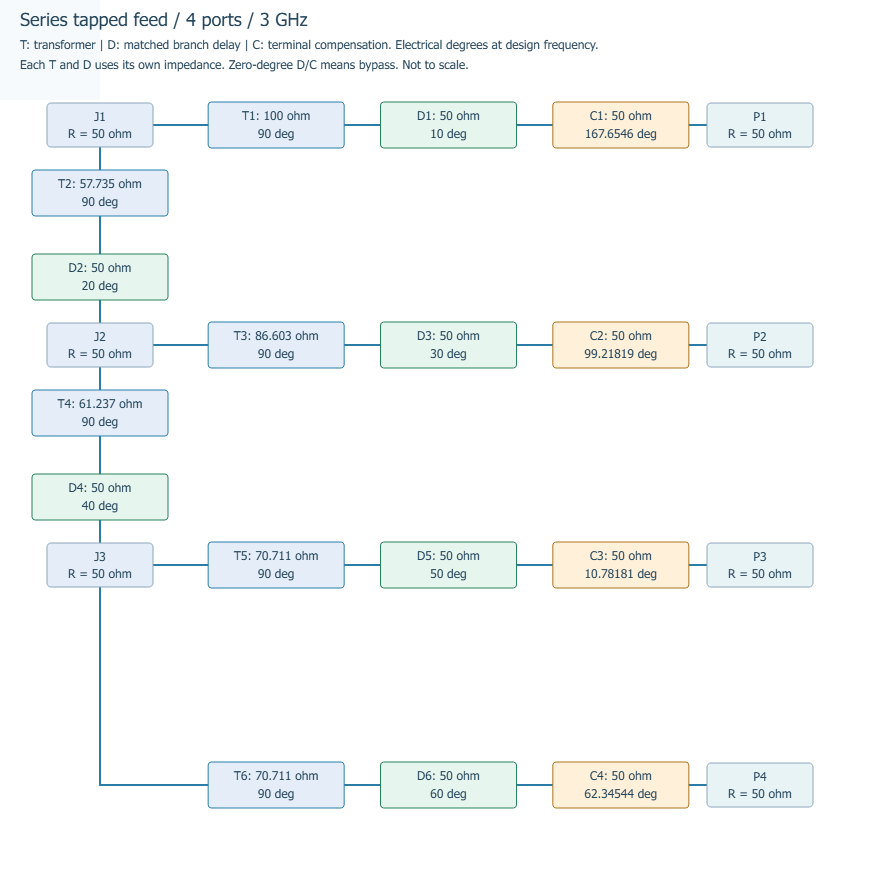

# 直线阵支路匹配延迟

每条支路可以在固定90°阻抗变换段之后增加一段匹配传输线。附加电长度范围为0–3600°，默认0°；它在当前设计频率处产生等量的相位滞后，并影响该支路下游的所有阵元。

## 从界面设置

1. 选择“直线阵馈电”，设置阵元数和馈电拓扑。
2. 在右侧“馈电网络”页打开“支路电长度…”。
3. 根据T编号、起点和终点，在“附加延迟 (°)”列输入电长度。变换阻抗、匹配阻抗和固定90°段只读。
4. 点“应用到待计算设置”，再按F5生成新设计。应用设置本身不会改写已有结果。
5. 在“支路参数”、端口表和连接图核对变换段、支路延迟段、末端补偿段及路径累计值。

“全部清零”会在应用后清除延迟绑定。修改阵元数或拓扑后，原T编号不能直接复用；程序拒绝生成，需打开电长度窗口重新设置或清零。取消编辑保留原设置。

## 三种线段与相位

| 标记 | 用途 | 阻抗与电长度 |
| --- | --- | --- |
| T | 阻抗变换段 | 原有变换阻抗Zₜ，固定90° |
| D | 支路匹配延迟段 | 阻抗等于该支路下游节点的等效阻抗，电长度由用户设置 |
| C | 端口末端补偿段 | 阻抗等于负载阻抗，电长度由扫描／等相补偿及相位量化设置确定 |

顺序为“父节点 → T变换段 → D匹配延迟段 → 子节点”。若子节点是阵元端口，末端C段位于其负载之前。T和D采用不同阻抗，不能将两段的电长度相加后当成同一阻抗的一条线。

匹配延迟段以其下游等效电阻作为特性阻抗，因此在设计频点不改变原有输入匹配和名义功率分配。输入至端口的原始网络相位为路径上全部T、D电长度之和的负值；路径累计值保持正数且不对360°取模。

既有阻抗上下限提示针对T变换段；D段阻抗按下游等效电阻自动取值，C段按负载电阻取值。它们不是实体工艺可实现性的判断。

例如，某条支路增加45°，该支路以下的所有端口原始网络相位都再滞后45°。在“不补偿”模式下，输出直接体现这一变化；在“按目标指向补偿”或“等相补偿”模式下，末端C段会重新计算，所以最终波束可能继续保持目标。要单独观察D段影响，可以选择“网络原始输出”方向图。

“电气模型输出（最终）”包含实际施加的C段及当前扰动设置。0.23.0.dev1起默认单独绘制所选来源；只有明确选择“补偿前后对比”才同时画目标、未补偿与最终曲线。例如8元0°串馈的未补偿峰约27.49°，加入对应C段后最终峰为0°，两条曲线不能混作同一个结果。

最终路径电长度为T路径累计＋D路径累计＋已应用C段电长度。单次相位误差不是设计的传输线长度，不计入此总数；失效端口仍保留匹配网络路径，但辐射相位可能不定义。

## 串馈最后一级

最后一个分配节点仍有两条支路：抽头接倒数第二个负载，续传支路接最后负载；没有额外终端电阻。默认等幅、节点及负载均50Ω时，末级两支路各分一半功率，变换线均约70.71Ω、90°。附加D段及C补偿段按各自设置计算，不能因两条T相同就推定全部电长度相同。

0.22.0的示意图把末端续传线从最后节点底部沿主干向下画出，再横向接入最后负载；普通串馈和对称串馈两臂均采用此画法。调整仅影响连接图的可读性，T/D/C的阻抗、相位、功率和模型节点不变。单端口保持匹配支路；对称两端口保持输入直接等分结构。



电长度除以360°表示该段导波波长的比例。它不能直接乘自由空间波长换算物理毫米长度。频率修改后代表在新频点重新设计；本功能不是固定实体线长的扫频、宽带或真时延分析。物理尺寸继续暂缓。

## 无头与导出

参数保存、计算记录恢复和结果导出均保留支路设置。`feed-sections.csv`包含T段与D段各自的阻抗和电长度；`feed-ports.csv`包含原始网络路径、末端补偿和总电长度；`feed-network.svg`标注独立T/D/C段。

命令行可以读取已保存的馈电配置，或用完整CSV重新设置支路：

```powershell
python -m arraylab --headless --elements 4 --feed-network corporate --feed-phase none --feed-branch-delays examples/feed-branch-delays.csv --output-dir results/branch-delay
python -m arraylab --headless --feed-config results/branch-delay/feed-config.json --feed-phase scan --output-dir results/branch-scan
python -m arraylab --headless --feed-config results/branch-delay/feed-config.json --elements 8 --clear-feed-branch-delays --output-dir results/reset-delay
```

CSV表头为`section,delay_deg`。需要完整提供当前T1至T末，每个编号一次；行顺序可调整，零延迟也需明确填写0。只允许有限的0–3600°数值。`--feed-branch-delays`与`--clear-feed-branch-delays`互斥，必须同时指定馈电配置或馈电拓扑。更改阵元数或拓扑时，须显式清除旧绑定或提供匹配新网络的完整CSV。

## 文件兼容

新的馈电配置及结果为schema 3，增加`branch_delays_deg`、`branch_delay_elements`、`branch_delay_topology`。延迟数组按最终从输入到负载排列的T编号解释，后两项防止把旧支路值错误套入新网络。

旧馈电配置1、2及历史报告2仍可读取，视为支路延迟为0。旧历史保留保存时的数值，不重新求解。共用馈电设置的平面阵与扫描配置/结果升级为schema 2，兼容旧配置1；其已有非零支路设置可以随配置和计算传递。本轮提供逐支路编辑窗口的是直线阵馈电页。

旧程序不支持新版本文件；应使用新程序打开，避免遗漏电长度。未知字段、混合版本、错误绑定或不一致的路径电长度会被拒绝。
