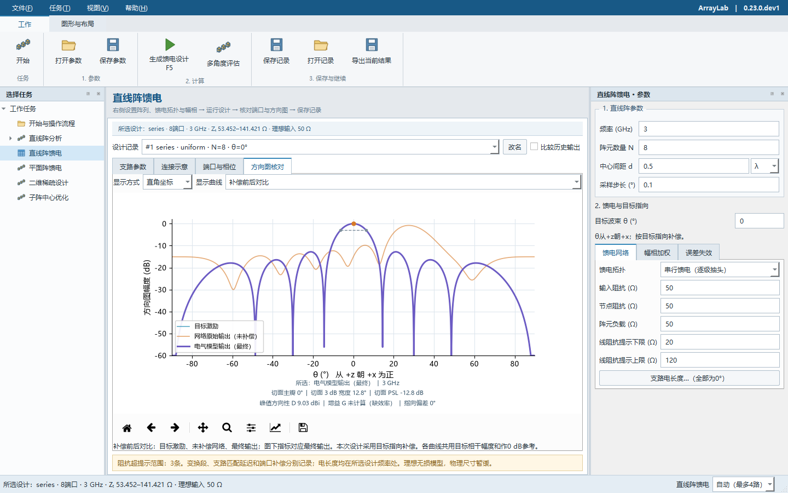
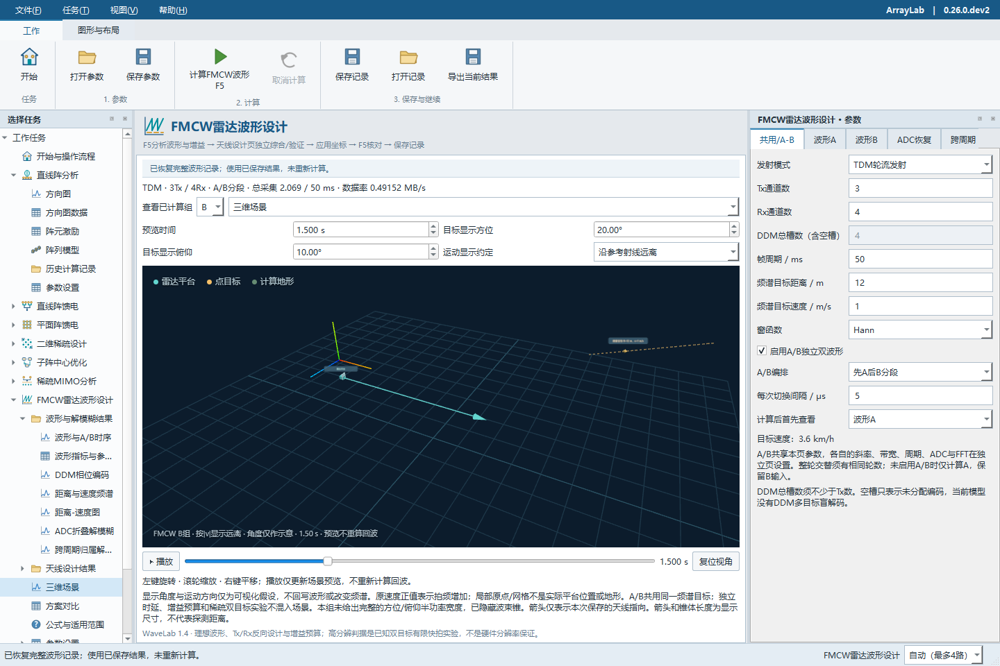
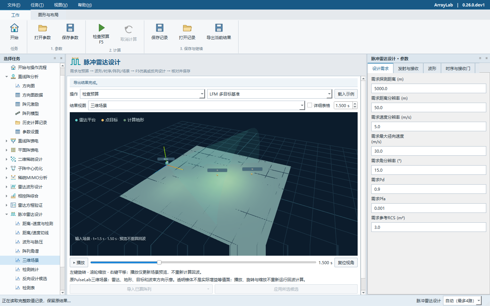

# ArrayLab 软件使用说明书

**版本 {{VERSION}} · 中文桌面版与无头命令行**

阵列分析、理想馈电电气设计、稀疏阵列、MIMO与雷达设计工作台。

本手册按“选择任务 - 设置输入 - 显式计算 - 核对结果 - 保存或导出”的实际操作顺序编写，覆盖现有十个业务任务。参数含义与结果解释以本版代码、示例和随包文档为依据。

**适用读者**：需要开展阵列方案比较、馈电电气核算、稀疏布局研究及雷达合成场景分析的工程人员、研究人员和学生。

**阅读约定**：本手册中的算例是操作起点，不预先承诺目标指标；界面显示的成功计算不等于工程要求达标。图形、表格、文件所对应的输入快照应始终一致。

**交付组成**：桌面程序 ArrayLab.exe；无头程序 ArrayLab-cli.exe；examples 示例；docs 专题文档；licenses 第三方声明；本PDF及可编辑说明书源码。移动程序时保留整个目录和 _internal。

编写日期：2026-10-28。界面截图和历史验证另见随包 docs；本手册不把历史测试数量当成本次重新验证结果。

<!-- page -->
## 阅读导航

第一次使用建议先读第3至8页，再选对应业务章节。批量运行请读第32至33章；文件、升级和问题排查请读第30、34至36章。

{{TOC}}

<!-- page -->
## 01 软件定位与任务选择

ArrayLab将独立业务任务放在同一工作台中。不同模块的角度、增益、坐标和统计口径可能不同，应使用明确的导入入口交换已计算快照。

| 工作目标 | 选择任务 |
| --- | --- |
| 均匀直线阵扫描、二维/三维方向图 | 直线阵分析 |
| 并联、串行、1分2后对称串馈电气设计 | 直线阵馈电 |
| 规则或自定义x-y平面阵的馈电与方向图 | 平面阵馈电 |
| 从候选位置选择阵元并比较稀疏方案 | 二维稀疏设计 |
| 固定内部模板，连续优化子阵中心 | 子阵中心优化 |
| 分别指定Tx/Rx，分析虚拟阵列和数字波束 | 稀疏MIMO分析 |
| FMCW、A/B时序、解模糊、雷达天线设计 | FMCW雷达波形设计 |
| 固定移相/真时延、扫描与一维/二维综合 | 相控阵综合 |
| 能量预算、实际接收链及检测统计核对 | 雷达方程验证 |
| 脉冲、LFM、编码、步进频及运动地形场景 | 脉冲雷达设计 |

### 使用边界
阵列与馈电模块以理想电气/标量模型为主；没有完整全波、互耦、极化和制造尺寸设计。数字波束、方向性与真实硬件增益不可混用。雷达统计和高分辨实验有各自假设，不能由一次合成计算推导硬件验收结论。

<!-- page -->
## 02 安装、启动与升级

### Windows便携版
1. 从项目Release下载对应版本Windows x64压缩包，并核对同版SHA-256校验文件。
2. 完整解压到新的目录。不要只复制一个EXE，也不要混合不同版本的 _internal。
3. 双击 ArrayLab.exe。脚本或批处理使用同目录的 ArrayLab-cli.exe。
4. 按需进入业务模块。启动或打开参数文件不会自动开始新的综合。

### 源码运行
源码树中保留 pyproject.toml、requirements-lock.txt、examples 和构建工具。以下命令在源码根目录执行；使用已安装Python创建独立环境。

```powershell
python -m venv .venv
.\.venv\Scripts\python.exe -m pip install ".[desktop,radar]"
.\.venv\Scripts\python.exe -m arraylab
```

desktop包含桌面绘图和离线三维视口；radar包含GeoTIFF读入与坐标转换依赖。只用无头数值接口时不需要Qt；需要PNG时还需绘图依赖。固定依赖版本和实际验收环境以本版验证记录为准。

### 升级与搬迁
升级前保存未留存的输入和重要计算记录。保留旧目录可方便查看旧版本；不要覆盖正在使用的程序文件。直线阵与二维稀疏的自动历史不是完整项目备份，重要结果还应导出独立文件。旧版本生成的相控阵/方程记录可能被标为旧算法快照，需按新版重算。

<!-- page -->
## 03 工作台与快捷键

工作台分为左侧任务树、中间结果区、右侧参数区和顶部操作区。任务树可展开到结果视图或参数页；点击导航只切换位置，不运行计算。长名称可悬停查看，窄窗口可滚动。

| 操作 | 快捷键或入口 |
| --- | --- |
| 回到开始页 | Ctrl+Home |
| 运行当前任务 | F5；顶部当前任务计算按钮 |
| 直线阵馈电 / 平面阵馈电 | F6 / F7 |
| 二维稀疏 / 子阵中心 | F8 / F9 |
| 稀疏MIMO / FMCW波形 | F10 / F11 |
| 打开 / 保存当前参数 | Ctrl+Shift+O / Ctrl+Shift+S |
| 打开 / 保存计算记录 | Ctrl+O / Ctrl+S；仅对应任务支持时可用 |
| 导出当前结果 | Ctrl+E |
| 当前任务帮助 / 退出 | F1 / Ctrl+Q |

相控阵、雷达方程和脉冲模块从任务树或开始页选择，没有额外专用F键。它们在页面上先选“操作”，再按F5执行该操作。

“视图”菜单可重新显示参数、任务、消息停靠区；“恢复工作布局”恢复常用位置。拖动分隔线时图像可能临时缩放，停止后完成精确绘制。观察正式数值应等绘制完成。

图片保存/复制针对当前图形。不能将“保存图片”当作保存参数或完整结果。底部计算资源选择作用于之后启动的任务，不改变已经生成的结果。

<!-- page -->
## 04 一次计算的完整闭环

### 五步操作
1. 选择正确的业务任务，确认右侧标题与当前任务相同。
2. 填写参数，或打开该任务的参数文件。载入文件后检查频率、单位、角度、模型和算法选项。
3. 明确选择要运行的操作，再按F5。综合、预算、回波仿真、校准和统计不是同一操作。
4. 检查完成状态、警告、表格与图形。特别核对输入快照、当前方案/工况、图形来源及指标参考。
5. 保存参数以便重算，保存记录以便回看数值，导出以便外部使用。

### 三种保存不可互相代替

| 操作 | 保存内容与下一步 |
| --- | --- |
| 保存参数 | 当前编辑输入，可能尚未计算；打开后需要运行 |
| 保存记录 | 上次成功结果及其输入、选择状态；恢复时尽量使用原数值 |
| 导出结果 | 当前成功结果的报告、表格、数组或图形；内容随模块不同 |

改参数后，中间结果仍可能是上次成功的快照。不能把新输入的标题或设定角当作旧图的输入依据。失败、取消或非法输入不会用未完成结果替换上次成功结果。

直线阵每次成功F5自动记录；二维稀疏按成功综合/加权自动留存。其它任务的完整记录能力不同，见第35章矩阵，不能假设所有模块都有自动历史。

<!-- page -->
## 05 单位、坐标与角度

同一符号在不同模型中不一定表示同一方向。跨模块优先使用已提供的导入按钮；手工复制时必须转换坐标与单位。

| 模块 | 约定 |
| --- | --- |
| 直线阵二维切面 | 阵列沿x；θ从+z朝+x为正，通常为-90°至90° |
| 平面阵、稀疏、MIMO | 阵列在x-y平面；θ从+z量起，φ从+x朝+y；u=sinθ cosφ，v=sinθ sinφ |
| 相控阵综合 | X/Y为方向角，u=sinX、v=sinY；不是普通方位/俯仰；需处于可见圆盘 |
| 雷达方程、脉冲场景 | x前向、y左向、z向上；空间位置用米 |
| FMCW天线布局 | 输入x,z的波长坐标；固定参考频率时保持物理布局 |

λ通常表示当前频率波长；λ0表示参考频率波长。频率变更时必须确认软件是保持米制坐标还是保持波长数。跨模块桥接会按其明确规则处理，不能仅复制一个数值。

界面按字段标注的GHz、MHz、μs、mm、Ω、°输入。相控/方程/脉冲原生表单可能将内部SI量缩放到工程单位显示，保存文件仍使用其原始数据约定。

阵列正扫描通常需要与传播项相抵消的馈相。自定义相位可能是附加偏置，也可能是实际馈相；不能把含扫描相位的整套激励再次作为偏置叠加。三维显示的法线、球面角和二维切面代表角也不可直接互换。

<!-- page -->
## 06 方向图与指标如何读

方向图下方摘要对应当前成功快照、方案、工况及激励来源。归一化图上的0 dB表示参考电平，不是0 dBi硬件增益。

| 指标 | 正确解释 |
| --- | --- |
| 主瓣/代表峰 | 所选切面或可见区域的代表峰；有等高峰时不能宣称唯一指向 |
| 3 dB宽度 | 相对该峰下降约3.0103 dB的两个半功率交点之差 |
| 方向性D | 完整空间模型的峰值与平均辐射强度之比；通常以dBi表示 |
| 增益G | 还需要效率、损耗等参考；缺少数据时不应由D直接替代 |
| PSL/SLL | 指定主瓣排除区以外的峰值电平；不同排除区和参考不能直接横比 |
| 指向偏差 | 输出峰相对有效目标的差；多峰/全向场可能未定义 |

例如实际峰为-2 dB，半功率交点在约-5.0103 dB，而不是固定图线-3 dB。若曲线没有两侧交点、平坦或处在边界，缺省值不表示宽度为0。

线阵在三维中可呈圆锥等响应；理想z=0平面阵可能有上下半空间对称峰。局部两条正交大圆切面的宽度不等于唯一空间波束，也不是双目标分辨率。

采样网格可能漏掉窄瓣或旁瓣。看见更低的采样PSL不构成连续角域最优证明。相控阵的深度数值底用于数值诊断，不是可测动态范围或物理噪声底。

<!-- page -->
## 07 直线阵分析

### 输入与运行
选择“直线阵分析”，填写频率、阵元数、中心间距及单位、相位模式、扫描角和采样步长。设置合法后按F5。输入不能代替已选记录；每次成功计算都会生成新的历史快照。

| 常用输入 | 操作建议 |
| --- | --- |
| 频率 | 与间距单位一起检查；mm输入表示物理距离 |
| 阵元数N | 必须是合法整数；单阵元没有唯一扫描主瓣 |
| 中心间距d | 半波长可作为熟悉界面的起点；大间距应检查栅瓣 |
| 扫描角 | 确认相位模式使用扫描角，不只改数值 |
| 采样步长 | 决定输出曲线密度，细网格并不代表新的物理精度 |

### 核对顺序
先看“阵元激励”和“模型示意”，确认阵列轴、位置及相位；再看方向图及数据表。显示方式可切换直角、极坐标和三维。需要比较旧结果时，选择相应历史记录并单独控制叠加；三维通常只显示当前所选记录。

外部二维曲线可通过文件菜单读入。它是外部数据，不自动获得阵列模型、三维响应或全空间方向性。导出曲线与完整球面数据是不同输出。

若目标角与峰角不同，先核对选中记录、相位模式和栅瓣，不应立即把差别归结为数值错误。

<!-- page -->
## 08 线阵实例与馈电交接

以 3 GHz、8 阵元、0.5λ 间距、20°扫描和0.1°采样完成一次F5，核对激励、模型和方向图后再继续馈电设计。

1. 在历史记录中选中需要继续设计的成功快照。
2. 点击顶部“将该阵列导入馈电设计”。读取的是所选记录，不是尚未计算的输入框。
3. 在馈电页核对阵列、频率、间距、目标角和相位补偿模式。
4. 设置拓扑、阻抗、幅相及支路延迟，按F5生成设计。
5. 对比目标与最终输出，核对有效目标和物理端口顺序。

下面的0°串馈例中，未补偿网络可指向约27.49°，完整补偿后的最终输出才指向0°。默认看最终输出；明确选择对比后才同时显示三条来源。



<!-- page -->
## 09 直线阵馈电：拓扑与阻抗

F6进入直线阵馈电。阵列几何与线阵分析有共用输入，但结果各自保存。馈电设计使用纯电阻负载、理想节点和无损传输线；先设计电气阻抗与相位，不输出实体基板尺寸。

| 拓扑 | 结构与主要检查 |
| --- | --- |
| 并联树形 | 连续端口递归二分；非2的幂数量允许不等分和不同路径级数 |
| 串行逐级抽头 | 每级抽出一个端口功率，余量续传；末级两路分别接最后两个负载 |
| 先1分2再对称串馈 | 左右镜像两臂，从中心向外抽头；要求偶数N及镜像目标幅度 |

输入阻抗是入口参考面期望电阻；节点阻抗是内部下游节点等效电阻；阵元负载是各端口共同电阻。它们不等同于每条线的特性阻抗。上下限只是阻抗筛查阈值，超限不等于物理上一定不能实现。

对支路局部功率比例f、父节点电阻Rp及下游电阻Rc，中心频点的变换关系为：支路输入电阻=Rp/f，四分之一波长特性阻抗=sqrt(Rp×Rc/f)。非均匀分配以目标电压幅度平方计算功率权重。

8 端口、输入/节点/负载均 50 Ω：并联等分支路约 70.71 Ω；普通串行首级抽头约 141.42 Ω、续传约 53.45 Ω。此算例用于核对输入与拓扑，并不证明带宽、隔离或可制造性。

<!-- page -->
## 10 馈电幅相与方向图核对

### 建议顺序
先选拓扑和阻抗，再设置目标幅度与相位模式。若要按指定目标角扫描，明确选择“按目标指向补偿”；只填目标角不会自动改变其它相位模式。

| 来源/模式 | 作用 |
| --- | --- |
| 目标激励 | 需要实现的端口相对幅相 |
| 网络原始输出 | 经过变换与支路延迟，但未加入末端补偿 |
| 电气模型输出 | 含实际应用补偿、量化及已设单次扰动的结果 |
| 不补偿 | 保留原始路径相位，不能要求主瓣自动对准目标角 |
| 正侧向补偿 | 以0°为有效目标 |
| 按目标指向补偿 | 按所设目标方向求末端补偿 |

自定义CSV相位是附加偏置。若其中已含扫描馈相，再套一次扫描补偿可能导致重复调相。幅度量化、相位量化、单次误差和失效也可能使实际输出偏离目标。

检查“支路参数”是否符合功率分配及阻抗提示；检查“端口与相位”每个端口的路径、幅度与补偿；最后查看方向图。三种激励共用目标相干幅度作为参考，不分别把各峰强制抬到0 dB。

设计记录下拉框用于恢复已有设计；需要跨次启动保留时应保存完整记录。输入改动后仍导出上次成功设计，直到再次F5。

<!-- page -->
## 11 支路电长度

直线阵馈电的“支路电长度”窗口为每条变换支路设置额外匹配延迟。应先确定阵元数与拓扑，再编辑支路；数量或拓扑变化后，显式清除旧绑定或重新完整填写。

| 标记 | 含义 |
| --- | --- |
| T | 阻抗变换段，设计频点为90° |
| D | 变换段之后的匹配延迟，参与下游端口相位 |
| C | 每个端口实际应用的末端匹配补偿 |

原始网络相位等于沿途T、D电长度总和的负值；最终路径电长度还包括实际C。单次相位误差不是线长，不应计入电长度总数。

在一条上游支路增加45°，其所有下游端口原始相位均额外滞后45°。若采用目标扫描补偿，C会随之重算，最终主瓣可能不变。查看“网络原始输出”才能直接观察D的影响。

串馈最后一级仍有两条支路，没有额外终端电阻。图上连接距离只作结构示意，不参与相位计算。

### CSV与单位
CSV表头为section,delay_deg；T1至末支路需完整且每个编号一次，零延迟也填写0。允许值与错误绑定由程序校验。CLI使用--feed-branch-delays；清除绑定用--clear-feed-branch-delays，两者互斥。

电长度除以360°得到导波波长比例。没有介质和实体路径模型时，不能直接乘自由空间波长得到物理毫米长度；频率修改表示在新频点重新设计。

<!-- page -->
## 12 平面阵馈电

F7进入平面阵馈电，使用本任务独立的布局、频率和角度。支持矩形网格及任意x-y坐标；所有阵元位于z=0平面，采用各向同性点源，无地平面、极化或互耦模型。

### 操作步骤
1. 选择规则布局，设置Nx/Ny、间距及单位；或导入有效自定义坐标。
2. 设置频率、目标θ/φ、方向图切面φ和采样参数。目标方向与切面方位不是同一项。
3. 选择馈电拓扑、幅度、附加相位及补偿模式。检查自定义端口行顺序。
4. 按F5，查看坐标表、切面、上半球图、全空间三维阵因子及网络表。
5. 核对主瓣、等高峰、方向性与端口相位，然后导出新的结果目录。

### 规模与转移
当前电气模型有独立阵元数、孔径、重复点和幅度动态范围限制。稀疏模块允许更大候选规模，不代表所有结果都能直接进入平面馈电。导入失败时查看具体原因，不要自行删阵元凑数而仍称为原方案。

任意坐标使用文件/输入中的排列作为端口编号依据。坐标单位改变或频率改变时，应确认物理布局是否保持；波长数与毫米数不可混填。送入平面馈电的输入仍需重新计算，旧电气结果不会自动更新。

本模块支持参数保存及结果导出；不要假设它拥有与直线阵完全相同的自动多次历史。

<!-- page -->
## 13 多扫描角评估

直线阵/平面阵馈电已有结果后，可使用“评估多个扫描角”。扫描评估用于比较指定工况，不等于固定实体馈线的宽带实测。

### 运行与阅读
1. 先确认基准馈电报告来自需要的阵列和阻抗方案。
2. 设置扫描角列表、补偿/量化等评估条件，检查范围与顺序。
3. 运行后查看扫描总览、逐工况指标与选定点方向图。
4. 若有多个等高峰或半功率交点缺失，保留未定义状态；不要用单个代表角掩盖栅瓣。

计算过程会保持公共方案及明确的随机实现口径；并行只改变调度，不应改变科学条件。切换选定工况不重新抽取误差。

| 常见比较 | 应保持一致的条件 |
| --- | --- |
| 连续补偿与量化补偿 | 相同阵列、权重、频率、角度列表与其它误差 |
| 不同馈电拓扑 | 相同目标输入与端口编号；说明各网络路径差别 |
| 不同扫描角 | 同一归一化参考及指标定义，注意可见域边界 |
| 不同软件版本 | 保留来源版本；涉及算法修复时重新计算 |

目标方向D与全局峰值D含义不同。逐角优化、逐频率重新理想调相也不代表真实固定移相器或实体馈线的频率行为，应使用对应模块支持的模型。

<!-- page -->
## 14 二维稀疏：开始一次综合

F8进入二维稀疏设计。候选位置、约束和工况在右侧设置，结果在中间选择。本模块原生嵌入ArrayLab，不调用独立Demo窗口。

1. 设置Nx、Ny、目标阵元K、参考频率及间距。任意正整数不代表任意组合都可行。
2. 选择中心对称、禁布区、最小间距，以及扫描角/频率工况。
3. 检查单元模型、优化方法、采样和种子。首次操作可打开examples/sparse-basic.json。
4. 点击“开始稀疏综合”或F5，观察阶段、已用时间与取消状态。
5. 综合完成后选择具体方案，再检查布局、方向图、切线、逐阵元幅相和工况指标。

布局与二维方向图并排显示，并跟随方案、工况和相位来源。改变参数而未综合时，旧结果继续对应成功快照。界面中的“恢复已计算参数”可将选中结果的输入恢复到表单。

综合是有种子的有限搜索和数值优化，未找到可行方案不是数学不可行证明。不要仅凭某个图中“很低的旁瓣”判断优劣；需核对排除区域、采样密度、单元模型和归一化参考。

后台任务失败或取消时保留旧结果，不发布部分方案。规模较大时应根据资源预估和实际阶段判断，不能仅因图形暂未更新就重复启动任务。

<!-- page -->
## 15 二维稀疏：约束与规模

| 选项 | 规则与检查 |
| --- | --- |
| Nx、Ny、K | 正整数；K不超过候选总数及约束下可用数量 |
| 中心对称 | 偶数K选择反演对；奇数K需奇×奇网格且中心可用 |
| 中心禁布 | 无孔、矩形或圆形；圆形X尺寸为直径 |
| 最小间距 | 实际二维欧氏中心距；0表示不追加此限制 |
| 多工况 | 同一物理布局和幅度在多角/多频条件下复核；数量受程序限制 |
| 单元响应 | 点源、标量近似或CSV；非各向同性总场另有空间范围限制 |
| 相位量化 | 属于固定布局复核，不自动变成量化感知优化 |

奇数K必须保留中心阵元；中心被禁布或间距限制排除时，不会偷偷减少K。奇×奇网格配偶数K时，参考方案会说明中心不参与。

单行/单列网格可以输入，但退化孔径可能没有可优化副瓣区域。例如主瓣排除区覆盖整个可见域时，不能生成虚假的PSL。

启动前按候选阵、采样、工况与并行数预估内存。超预算会拒绝启动并保留输入；程序不会为了运行而自动降低K、采样或删掉方法。预计内存也不是求解时间和实际峰值的精确保证。

大孔径通常需要更密的优化与复核网格。增加采样能改善证据，但有限网格不保证找到连续区域最坏峰。

<!-- page -->
## 16 稀疏结果、加权与历史

同次综合可能返回多个方案。先选方案与工况，再核对布局、幅相和指标。L1加权对照可能是可变阵元数，不能直接当作固定K结果。不同排除区、孔径或单元模型的PSL不可直接排序。

加权、重新复核和原始综合是不同操作；切换图形不重新优化。成功综合和加权自动留存，左侧“本次综合方案”与“历史计算记录”分开显示，重启后按需恢复。

选好结果后可“送入平面阵”。仅目标电气模型支持的点源、数量、孔径和幅度范围可转移，不删点凑数。导入理想坐标/幅度并建立可编辑初值，原绝对相位量化码不直接迁移；目标页需要再次F5。


重要方案还应导出完整目录，不仅依赖自动历史。待计算输入不会篡改旧成功方案。

<!-- page -->
## 17 子阵中心优化

F9进入该任务。它固定子阵数量与内部矩形模板，在给定孔径内连续移动完整子阵中心。不是在候选网格上选点，也不重新划分已有阵元。

### 设置与计算
填写子阵数量、内部Nx/Ny及间距、总孔径、中心禁布区、实际阵元最小间距；设置扫描工况、主瓣排除半宽、优化/复核网格、尝试次数、重启次数和种子，再运行。

内部阵元与子阵公共相位均随每个目标工况理想调相。相同物理布局参与多个频率/角度，频率列表与角度列表采用组合，不是逐项配对。

| 查看内容 | 解释 |
| --- | --- |
| 中心与展开阵元 | 约束检查针对实际阵元和模板包络，而不只检查中心间距 |
| 初始/最终布局 | 与同一工况、同一主瓣排除区比较 |
| validation_reverted | 复核发现候选更差时回退初始布局，不是隐藏失败 |
| PSL与宽度 | 有限采样和指定区域定义；排除区过宽可能漏掉需要检查的峰 |
| 方向性与增益 | 全空间理想阵因子可计算D；缺效率时不报告硬件G |

可以保存参数、导出中心/阵元坐标、逐工况指标与图形。该任务没有与直线阵相同的完整自动历史恢复界面；保存输出目录以保留计算证据。

<!-- page -->
## 18 稀疏MIMO：输入与场景

F10进入稀疏MIMO分析。分别指定Tx与Rx的物理位置和数字幅度，计算给定布局的虚拟几何、通道与波束指标；该模块不执行位置优化或DOA算法。

1. 选择一维或二维、频率、坐标单位、目标θ/φ及切面φ。一维沿x轴，φ固定为0。
2. Tx/Rx各自逐行输入。一维为x,amplitude；二维为x,y,amplitude。幅度省略时为1；不用的阵元应删除整行。
3. 按F5，查看物理/虚拟布局、切面、二维图、通道映射和独特位置。
4. 保存参数供复算；保存完整记录供直接恢复；导出报告、CSV和PNG。

从直线阵或二维稀疏的已计算结果可导入Tx或Rx。导入几何与相对幅度，不复制原扫描相位。频率改变时需按接口规则保持另一侧已有米制布局，避免无意缩放。

虚拟位置采用rTx+rRx。Tx×Rx是通道对数；重合虚拟位置要保留重数，不能简单当成更少个等幅阵元。

数字幅度是合成权重，不是发射机功率。Tx/Rx数字因子的乘积不是实际硬件增益，也不代表所有体制都能无误差地分离通道。模型假定近共址、远场、窄带、静态目标和理想可分离正交波形。

<!-- page -->
## 19 MIMO实例与结果边界

### 一个可手工核对的几何例子
Tx=[0,0.5]λ，Rx=[0,0.5]λ，各幅度为1。4个通道对的虚拟位置为0、0.5、0.5、1λ；独特位置3个，重数为1、2、1。核对通道表与独特位置表应得到相同映射关系。

重合位置用于统计时按明确容差确定代表点；实际场计算保留原始坐标和全部通道，不先强制舍入为整数网格。

| 结果 | 不应推导的结论 |
| --- | --- |
| Tx数、Rx数、通道对数 | 不能直接等同硬件RF链数 |
| 独特虚拟位置与重数 | 不能直接等同可分辨目标数或通道矩阵秩 |
| 数字波束3dB宽度 | 不等同含噪双目标分辨率 |
| 目标处零指向差 | 来自理想相位构造，不是无误差硬件证明 |
| 归一化0 dB | 不等同实际辐射增益或SNR增益 |

有等高峰、平坦切面、缺半功率交点时，程序保留未定义状态。有限采样也可能漏掉很窄的峰，应加密复核。

需要带运动相位、编码或实际接收处理的分析时，进入对应雷达任务重新设置条件。MIMO几何页未包含互耦、TDM运动补偿、近场聚焦或硬件非线性。

<!-- page -->
## 20 FMCW波形与A/B编排

F11进入“FMCW雷达波形设计”。共用页设置TDM/DDM、Tx/Rx、帧周期、目标距离/速度和窗；波形A/B页设置各自的斜率、Ramp、空闲时间、采样与FFT参数。

### 操作顺序
先设置A，再启用A/B并填写B。选择先A后B分段或整轮交替、切换间隔，按F5。先看参数检查与时序，再读频谱和距离-速度图。结果A/B下拉框只切换已算快照，不改右侧输入。

| 参数 | 需要一起检查的条件 |
| --- | --- |
| Ramp、斜率 | 整段扫频带宽与规划频段 |
| ADC起点、点数、采样率 | 实际观测窗是否落在允许时间内 |
| 空闲/切换时间 | 总采集时长与帧预算；不能当作积累时间 |
| Tx数量与TDM | 同一Tx的重访间隔，而非相邻物理Chirp间隔 |
| DDM槽数 | 总槽数含空槽；通道数与编码周期约束 |
| FFT长度 | 不小于实际样本的合法值；补零只改变栅格 |

分段允许不同循环数；整轮交替按完整轮编排，循环数需匹配。两组各自使用自己的观测带宽和波长，不能直接把A/B带宽相加。FMCW页是既定理想单点目标与采样模型，不将DDM编码频谱展示冒充多目标盲解码。

<!-- page -->
## 21 FMCW指标与解模糊

| 指标 | 本模块口径 |
| --- | --- |
| ADC时间 | 采样点数/采样率 |
| 有效观测带宽 | 斜率×ADC时间，不一定等于整段Ramp带宽 |
| 名义距离分辨率 | c/(2×有效观测带宽)的孔径基准；窗会改变主瓣 |
| FFT距离/速度栅格 | 由FFT长度定义；不能代替物理分辨率 |
| 同组同Tx间隔 | 按实际TDM/A-B编排计算 |
| IF距离上限 | 采样与前端规划限制，不是能量方程探测距离 |

### ADC折叠实验
双采样率或双斜率实验根据测得折叠频率与已知采样条件枚举候选。模拟IF必须保留相应信号；错误速度先验可能导致偏差、多个候选或无一致候选。求解器不能用目标真距离挑选结果。

### 跨周期归属实验
这是独立时延观测级实验，使用两次均匀重复周期的时延余数及量化容差。它的实验目标距离独立于主波形目标，不是完整FMCW原始回波链，也不表示远距离探测能力。

状态分为关闭、不可解算、搜索范围内唯一、多个候选和无一致候选。候选区间不是置信区间；“唯一”受搜索范围和容差限制。额外采集时间不自动计入主波形帧预算。

<!-- page -->
## 22 FMCW天线与增益设计

右侧“天线设计”包含布局、反向设计、高分辨条件和增益预算。F5主要分析当前波形、天线及增益；耗时综合通过独立按钮显式启动。

1. 在布局页设置Tx/Rx坐标；每行x,z以波长表示。需要A/B保持同一物理孔径时，固定参考频率。
2. 反向设计中设置通道数、设计轴、孔径、间距、扫描范围、目标角间隔、旁瓣、种子与搜索预算。
3. 选择常规判据或MUSIC、MVDR、LS-ESPRIT、DML，并在高分辨页填写SNR、快拍、功率差、相干系数和容差。
4. “开始综合”搜索布局；“验证当前阵列”验证当前输入的一维布局。查看逐扫描中心及各次试验结果。
5. 应用综合坐标后，再F5核对布局与增益；应用候选本身不会将未达标结果改成达标。

高分辨实验使用已知双目标、有限含噪快拍与可分离且校相的观测。空间平滑、可提取ULA、处理维数及独特位置数量有约束。经验通过率不是硬件Pd或普遍角分辨保证。

增益预算根据目标RCS、距离、功率、实际ADC积累、噪声与损耗求所需每通道增益。应明确每Tx/总功率口径和A/B参考范围；虚拟通道数不能作为免费能量增益。反算等效口径也不是实体天线或馈线设计。

<!-- page -->
## 23 原三维场景与显示设置

FMCW和脉冲共用离线视口。左键旋转、右键平移、滚轮缩放；底部播放/暂停、时间滑条和复位视角控制预览。隐藏时暂停，播放不重新计算已保存数据。

FMCW默认把已提交的单目标放在局部参考射线上。显示角度与接近/远离约定只用于预览，不回写波形；原速度正值表示拍频增加。A/B共用同一目标，不混入独立预算或解模糊实验目标。



脉冲场景使用平台、目标及地形输入；真值不是检测点。透明锥体是方向示意，未知宽度时不编造锥体；箭头长度不是探测距离。保存完整记录可保留视角和时间，当前画面也可单独导出。

<!-- page -->
## 24 相控阵：分析与扫描

从“相控阵综合”进入，选择规则线阵、矩形阵或自定义坐标，设置参考/分析频率、指向、窗、附加相位与量化位数。选择“更新阵列分析”后按F5。

参考频率定义输入波长坐标的物理尺度。分析频率用于当前场响应；固定移相与真时延的频率行为不同，应明确选择。X/Y是方向角，需满足可见圆盘条件，不能直接用普通方位/俯仰替代。

查看阵列幅相布局、X/Y切面、二维u-v图及指标。逐阵元表中实际馈相跟随当前工况。三维“空间场景”与相控阵u-v方向图不是同一功能。

### 扫描评估
填写扫描范围与步长，选择扫描操作再F5。通过波束宽度、副瓣、指向功率和峰偏等指标观察变化。缺值应结合状态/原因阅读：不可见主阶、无有效孔径或主瓣被截断时，不强行给出有误导性的数值。

相控阵与一般平面阵模块的坐标/指向定义不同。需要继续设计馈电时，使用“将所选工况送入平面馈电”，保留实际保存馈相，再在目标任务显式计算。

分析模型不包含阵元互耦、矢量极化、硬件误差闭环或完整球面积分验收；离散频率切片不是完整时域宽带收发仿真。

<!-- page -->
## 25 相控阵：一维与二维综合

一维综合及二维格点/连续综合由操作选择器显式启动。设置约束和搜索预算后再F5；载入示例不会自动运行优化。

| 设置/输出 | 使用方法 |
| --- | --- |
| 角度与频率工况 | 同一布局在多个条件下检查；看最差工况 |
| 主瓣排除区 | 影响区域SLL定义；缩小或扩大均需说明 |
| 位置/幅度变量 | 只允许选中的变量变化，固定条件应保留 |
| 迭代、种子 | 控制有界搜索与复现；不等于最优性证明 |
| feasible | 工程约束判定；不能只看improved |
| 回退信息 | 细验证不通过时可能交付基准而非较差候选 |

切换所选工况时，布局馈相表、切面和u-v图要一致。多工况导出分别提供元素表，当前选择另有视图说明。不能只从一个扫描角推断所有工况通过。

1.2.2来源修复后，粗细量化一致、极小幅度和大相位更稳定，细化峰与半功率宽度，主瓣截断不能通过小掩膜绕过。旧版本的可行性结论需要重算；旧记录本身仍保留原值。

原始切面CSV可低于绘图下限。极深抵消点受双精度限制，只作数值诊断，不解释为真实动态范围。有限网格和局部峰复核不证明连续频带/全角域或全局最优。

<!-- page -->
## 26 雷达方程：先核对预算

从“雷达方程验证”进入。选择示例或填写波形、功率/增益/噪声、通道、目标、传播、杂波、处理及资源条件。先选择“系统预算与反算”，再F5。

| 关键口径 | 检查内容 |
| --- | --- |
| 传导功率 | 区分每Tx与同时活动Tx总功率 |
| 天线增益 | 每个Tx/Rx通道所用增益；不从虚拟通道数推定 |
| 噪声 | 天线温度+接收NF，或直接Tsys，两种输入口径明确 |
| 积累 | 按真实ADC/脉宽、有效事件、窗和通道系数计算 |
| 可观测性 | IF、采样、接收窗、FIR、远场和运动边界，与能量预算分开 |

预算结果是独立能量参考。能量足够并不保证采样/收发时序可观测；预算曲线通过也不表示已完成回波或检测统计验证。先处理错误及不满足原因，再执行回波仿真。

从“导入已算阵列”选择来源与Tx/Rx侧；从“导入已算FMCW波形”导入当前已算A/B组。程序会转换坐标与单位，但保持目标模块未明确迁移的增益、指向等设置。交替A/B等不兼容情况会拒绝，不能拼接成虚假均匀采集。

更改通道数后可“按通道数重建规则阵列”；该操作会重建几何，使用前确认是否需要保留自定义位置。

<!-- page -->
## 27 雷达方程：仿真与统计

回波仿真、SNR核对、H0校准、独立统计、距离统计和ROC分别是显式操作。推荐顺序为：预算与可观测性检查 - 回波与检测 - 固定CUT SNR - H0校准 - 独立Pd/Pfa验证。

### CUT、校准与验收
CUT是预先指定的检测单元。新版校准/H0/H1/ROC使用一致口径，并将固定CUT检出、位置关联及多目标背景触发分别报告。只看到强目标触发，不能证明弱首目标存在。

H0校准只估计门限。尾部样本充分且指纹匹配时才能应用；应用后还需独立统计。低Pfa需要足够试验数，零虚警仍有非零置信上界。置信区间是逐项/逐点边际区间，不能自动当作多指标同时保证。

### 图与表
距离-速度图来自实际处理数组。检测表中的单元总功率/热噪声含信号、杂波和噪声，不是分离信号的SNR。参考总能量与多look功率和/噪声和须分清，不能把两者差额误称为处理损耗。

改变接收器、背景、CUT或算法版本后旧校准失效。旧算法记录可查看，但有持续重算提示，旧H0不能复用。检测CSV使用cell_power_to_noise_db；旧统计CSV有legacy_*列，外部脚本应按版本读取。

距离曲线只覆盖已采样点；不可观测、失败与证据不足状态都应保留，不能把未验证间隔填成达标。

<!-- page -->
## 28 脉冲雷达：波形与处理

从“脉冲雷达设计”进入，先载入基准示例，按需求与预算、发射接收、波形、时序、阵列、场景、处理、统计的顺序检查参数。

| 类型 | 主要用途与组合边界 |
| --- | --- |
| 矩形 / LFM | 常规脉冲与脉压；按支持条件选择均匀、交错PRI或多PRF |
| 二相码 | 脉内编码；与区分Tx的外层Walsh码不是同一编码 |
| 步进频 | 跨频相干合成与运动补偿；不与所有时序/MIMO模式任意组合 |
| TDM | 轮流Tx，使用真实事件时间和速度补偿；需满足接收窗条件 |
| CDM | 支持的2/4Tx完整编码块；高速越界可能串扰或失效 |

先执行“检查预算”，再选择“运行回波仿真”。检查距离-速度与检测、距离/速度切线、波形与脉压、角谱、模糊候选、场景及指标表。普通LFM距离可能是零多普勒匹配下的表观距离，不能忽略耦合。

对复杂组合，程序在运行前检查收发恢复、完整接收、频点/编码数量、时间精度、内存和算法适用性。不能为得到输出而绕过拒绝条件。

反向设计是有界候选搜索。应用某个候选后应显式重新分析；伴随数组属于报告指定的候选，不能当作原搜索输入重新运行的结果。

<!-- page -->
## 29 脉冲场景、地形与统计

位置为米制x前向、y左向、z向上。绝对高度与离地高度应有明确参考；目标真值用于合成及事后评价，不直接提供给估计器。

通过“导入GeoTIFF地形”读取受支持单波段文件，核对CRS、单位、垂直基准与重采样。NoData、网格外视线和未知AGL保持未知。显示网格与计算网格分开；DEM本身不提供真实反射率。



独立H0/H1统计分别报告固定CUT概率、场景关联和置信界；零事件不等于零概率。有界反向搜索和速度端点验证不证明数学最优。播放仅预览输入运动；需要新回波时显式重新运行。

<!-- page -->
## 30 记录、兼容与升级

| 数据 | 处理原则 |
| --- | --- |
| 参数文件 | 保存输入；打开不意味着已算结果有效 |
| 完整记录 | 保留成功快照、来源和数组；不能混入未计算修改 |
| 自动历史 | 仅适用于明确支持的模块，不能替代独立备份 |
| 旧算法结果 | 保留原数值与来源，需新结论时重算 |
| 旧H0校准 | 版本或配置/CUT指纹不匹配时不可复用 |
| 未知/损坏文件 | 拒绝恢复，不用部分数据覆盖当前成功状态 |

相控阵/方程/脉冲完整记录使用NPZ。导出目录的arraylab-record.json与arrays.npz应一起保留，摘要用于检查记录与数组对应关系。不要只移动其中一个文件。

FMCW含三维显示状态时使用新记录版本，继续读取原记录；旧软件不保证读懂新字段。MIMO、线阵/馈电、稀疏各有自己的格式，不能只改扩展名或format字段冒充另一模块。

旧参数在新模型下可能不再可运行，例如旧版遗漏的频带、FIR、远场或资源条件。打开历史快照与重新计算使用不同检查目的：能查看旧数值，不代表当前模型认可旧结论。

对外交换时同时注明软件版本、源模型版本、输入/记录文件、随机种子、工况、归一化参考、单位和输出类型。仅发送一张图通常不足以复现。

<!-- page -->
## 31 多核、内存与取消

工作台右下角选择自动、单核或2-8路，作用于下一次任务。自动模式对小任务串行，实际路数受CPU与独立任务数限制；不能用界面选择数推定始终占满所有核心。

多扫描点、平面方向图、稀疏方案复核、子阵重启及相控工况可采用有界并行。方程/脉冲限制数值库线程并保持随机试验顺序。部分网络综合、绘图或单次小计算仍串行。

### 遇到计算慢时
先查看任务阶段和资源提示；核对阵元数、候选数、工况、优化/复核网格、迭代和统计次数。它们对耗时的影响不同。先用较小可行规模掌握流程，再有计划地扩大，保留同环境对比记录。

超出预算时明确失败，不能将自动降采样或改变K假设为已有行为。大数组采用分块也不意味着任意规模都能在本机运行。

### 取消及异常
后台任务使用取消按钮。部分任务可终止受管计算进程，部分任务需等待正在执行的原生调用返回；以界面状态为准。不要通过重复启动来催促同一任务。关闭窗口时会先处理正在运行的任务和历史保存。

串并行复算时固定软件、输入、种子与算法选项，比较科学数值而不是耗时/执行路数元数据。不同求解器或不同软件版本可能产生不同但合法的多重最优解，应比较约束与指标。

<!-- page -->
## 32 无头命令行：基础用法

便携包使用ArrayLab-cli.exe。源码环境将前缀替换为python -m arraylab --headless。建议先查看对应子命令--help；不同模块的输出参数名字并不完全相同。

```powershell
.\ArrayLab-cli.exe --help
.\ArrayLab-cli.exe phased --help
.\ArrayLab-cli.exe equation --help
.\ArrayLab-cli.exe pulse --help
.\ArrayLab-cli.exe waveform --help
.\ArrayLab-cli.exe --sparse --help
```

### 操作约定
- 所有路径均按运行目录解析；包含空格的路径用引号。参数文件自身的相对资源路径按其接口规定处理。
- 优先将配置文件与输出目录显式写出。结果目录应尚不存在；已有目录拒绝覆盖，便于保留复现证据。
- --workers 0为自动，1为单核，2-8为所选上限。不要根据--workers猜测算法或随机流改变。
- 数值输出、进度与退出码应分别保存。稀疏子命令的进度为stderr JSONL；最终状态JSON在stdout，具体错误码见--help和接口文档。
- 没有图形参数时不应假设已经导出PNG。--plot的可选值随模块变化，不能统一套用all。

CLI不导入Qt，适合自动化数值任务。离线交互三维视口属于桌面显示；命令行场景PNG保留静态科学绘图方式。文件导出成功也不等于指标通过，应继续检查报告状态。

<!-- page -->
## 33 无头命令行：可复制起点

以下示例从便携程序根目录执行，输出目录名需要每次使用新名称。先检查同目录examples文件存在；请勿把示例数值当作性能承诺。

```powershell
.\ArrayLab-cli.exe --elements 8 --scan-deg 20 --output-dir results/linear01 --plot all
.\ArrayLab-cli.exe --feed-config examples/feed-series.json `
  --output-dir results/feed01 --plot all
.\ArrayLab-cli.exe --planar-config examples/planar-rectangular.json `
  --output-dir results/planar01 --plot all
.\ArrayLab-cli.exe --sparse run --config examples/sparse-basic.json `
  --output results/sparse01 --report
.\ArrayLab-cli.exe subarray --config examples/subarray.json `
  --output results/subarray01 --plot all
.\ArrayLab-cli.exe mimo --config examples/mimo-linear.json `
  --output-dir results/mimo01 --plot all
```

```powershell
.\ArrayLab-cli.exe waveform --config examples/waveform-ab-tdm.json `
  --output-dir results/fmcw01 --plot all
.\ArrayLab-cli.exe phased --config examples/phased-uniform-linear.json --action analysis `
  --output-dir results/phased01 --plot
.\ArrayLab-cli.exe equation --config examples/equation-01-fmcw-77-reference.json --action simulation `
  --output-dir results/equation01 --plot
.\ArrayLab-cli.exe pulse --config examples/pulse-baseline.json --action simulate `
  --output-dir results/pulse01 --plot
```

相控阵还可选择scan、optimize1d、optimize2d；方程可选择budget、snr、calibration、statistics、distance、roc；脉冲可选择budget、statistics、inverse。操作应与输入条件匹配。

脚本应检查退出码以及报告中的valid、feasible、validated或原因字段。这些字段属于不同模块，含义不能互换；不应只因进程退出0就判定工程达标。

<!-- page -->
## 34 常见问题处理

| 现象 | 先检查与处理 |
| --- | --- |
| F5无效/按钮灰 | 是否在开始页、是否已有后台任务、是否正在读写记录 |
| 图形与输入不一致 | 是否尚未重新计算；当前选中历史、方案、工况、A/B及激励来源是否正确 |
| 串馈主瓣不在目标角 | 相位模式、是否查看原始未补偿输出、支路延迟、量化/偏置和等高峰 |
| 稀疏规模无法开始 | K、对称奇偶、中心可用性、禁布/间距、主瓣排除区和内存预算 |
| 3D旋转慢 | 等待当前任务结束、确认显示预览和最终绘制；不要借降低计算精度隐藏问题 |
| 打不开记录 | 使用对应模块/版本；完整文件组合是否齐全；是否损坏或混用参数/结果 |
| 旧校准按钮不能用 | 算法版本、配置、CUT或尾部样本条件不匹配；重新校准和独立验证 |
| 没有3dB宽度/增益 | 可能无完整交点、非唯一峰、缺效率或模型不适用；不是零值 |
| 导出目录报已存在 | 使用新目录名，保留旧目录作为可复现快照 |
| DEM读入失败 | CRS、单位、垂直基准、单波段格式、NoData和明确重采样条件 |

报告问题时提供软件版本、任务名、可分享的参数文件、复现步骤、完整错误文字，以及所选方案/工况/图形来源。涉及实际工程数据时先确认分享范围；不要仅描述“图不对”。

若计算失败，先保留旧成功结果和当前参数，再调整明确不合法的条件。不得把错误提示改掉或强行读取旧“通过”字段当作修复。

<!-- page -->
## 35 文件与恢复能力速查

| 模块 | 推荐保存与恢复方法 |
| --- | --- |
| 直线阵 | 成功F5自动历史；另外保存JSON记录/参数，外部曲线另存 |
| 直线阵馈电 | 保存参数和完整设计记录；可打开完整feed-network报告；记录下拉框恢复已有设计 |
| 平面阵馈电 | 保存参数、导出报告/坐标/端口/图形；不假设有线阵式自动多次历史 |
| 二维稀疏 | 自动历史及完整结果目录；保存参数只保存待计算输入 |
| 子阵中心 | 保存配置，导出初始/最终中心、阵元、工况与图形 |
| 稀疏MIMO | 保存完整记录、参数、几何/通道CSV及PNG；无自动历史库 |
| FMCW | 参数JSON；完整记录含A/B、对比及可选场景状态；每组CSV/图形 |
| 相控阵/方程/脉冲 | NPZ完整记录；导出目录中记录JSON与arrays.npz成对保存 |
| 脉冲工程 | JSON或便携.prlab工程；导入地形需随工程保留 |

常见文件名可因模块而异：summary.json/report.json/result.json描述结果；parameters.json/config.json描述输入；CSV用于交换数值；PNG/SVG/HTML用于展示。不要仅凭文件扩展名判断其用途。

保存“当前图形”只得到当前选择的画面。完整导出往往包含更多工况/来源，阅读时检查文件名与元数据。多工况相控阵的元素表按case编号区分；FMCW文件按A/B区分。

对比记录应随主记录一起保存；单独复制数组或图片会丢失配置、单位、参考和版本。检查成果时建议同时保存参数、完整记录、导出目录和软件版本。

<!-- page -->
## 36 示例与专题文档索引

| 主题 | 随包入口 |
| --- | --- |
| 五步上手与导航 | docs/quickstart.md、task-navigation.md |
| 保存与历史 | docs/calculation-history.md、linear-feed-handoff.md |
| 馈电与支路 | docs/feed-impedance.md、electrical-design.md、branch-electrical-lengths.md |
| 平面阵与扫描 | docs/planar-arrays.md、scan-study.md |
| 稀疏/子阵/MIMO | docs/sparse-arrays.md、subarray-centers.md、mimo-arrays.md |
| FMCW与三组件 | docs/radar-waveforms.md、radar-components.md |
| 指标/交互/资源 | docs/pattern-metrics.md、3d-interaction.md、multicore.md |
| 版本与修复证据 | docs/releases/、validation.md、upstream-sync-0261.md |

examples目录包含与各任务对应的JSON、CSV及合成地形。示例名称说明用途；载入后仍需检查当前参数与所选操作，不会自动执行所有验证。重复运行使用新输出目录。

### 源码与复现
应用按framework、application、features和shared组织。业务模块通过公开入口协作；原来源组件和验证范围可在专题文档中追溯。完整源代码与运行包同步发布，构建入口见tools目录。

本手册源码为docs/manual/使用说明书.md，生成器为tools/build_manual.py。PDF采用随源码提供的Noto Sans SC开源字体，按OFL许可嵌入子集，中文可搜索；字体许可和来源在docs/manual/fonts中保留。

最终软件审计、修复根因、回归结果与剩余风险以本版随附验证报告为准。本手册是操作指南，不替代硬件测量、专业电磁设计或具体项目的需求验收。
