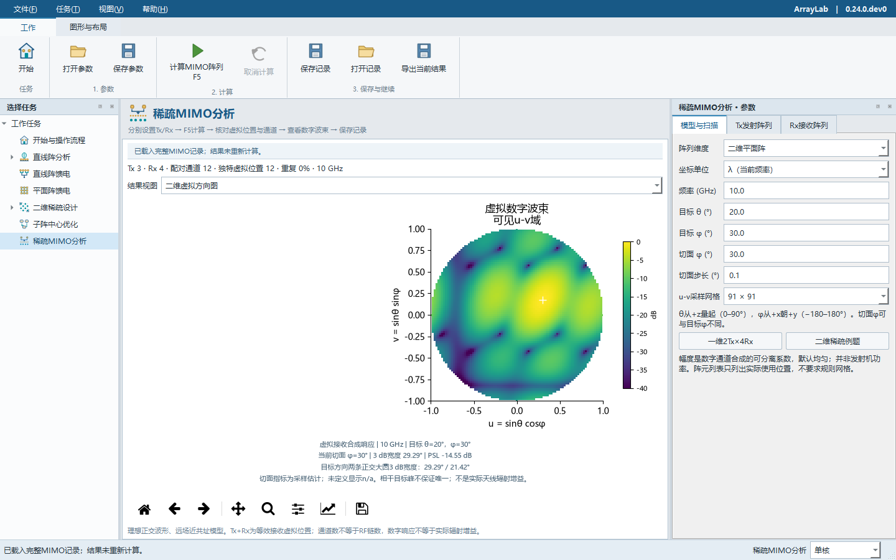

# 一维与二维稀疏雷达MIMO

从开始页“稀疏MIMO分析”、左侧任务树或F10进入。Tx和Rx分别输入，可使用沿x轴的一维阵列或x-y平面的二维阵列；删去未使用位置即可表示稀疏布局。本模块计算给定布局的参数，不执行阵元位置优化、DOA估计或训练网络。

该功能已纳入0.25.0正式版；此前的0.23.0正式下载包不包含MIMO模块。



## 操作

1. 选择一维或二维，设置频率、坐标单位、目标θ/φ以及方向图切面φ。θ从+z轴计；一维θ有正负，正方向朝+x。一维的φ固定为0。
2. 在Tx和Rx页分别输入坐标与数字合成幅度。一维每行`x,amplitude`，二维每行`x,y,amplitude`；幅度可省略，默认为1。幅度必须为正数，不使用的阵元直接删除整行。
3. 按F5计算；切换“布局”“切面”“二维波束”“通道”“独特位置”核对结果。场图和表格始终对应成功计算的快照。
4. “保存参数”保留当前输入，打开后需要重新计算；“保存记录”保留当前计算快照及视图，重启后通过“打开记录”恢复，不重新计算场或指标。MIMO首版不自动追加历史数据库。
5. “导出当前结果”选择一个新的目录，保存完整记录、参数、JSON报告、CSV表和PNG图。已有目录不覆盖。

直线阵和二维稀疏结果页新增“送入MIMO”菜单，可将**所选已计算快照**作为Tx或Rx。导入坐标与相对幅度，不复制原有馈相；目标扫描相位由MIMO页重新设置。频率改变时，另一侧现有坐标按毫米保留，避免因波长单位改变而缩放原物理布局。非各向同性稀疏单元不直接导入本理想点源模型。

## 几何、通道与权重

对第m个Tx和第n个Rx，一程波长约定下的虚拟坐标为`r_virtual = r_Tx + r_Rx`。完整通道表采用Tx优先顺序，通道、Tx、Rx及独特位置编号均从1开始。此定义来自[TI MIMO Radar说明第4页](https://www.ti.com/lit/an/swra554a/swra554a.pdf)；二维布局同样逐坐标相加。

分别报告Tx阵元数、Rx阵元数、Tx×Rx通道数、独特虚拟位置数、重复通道数、重复比例和最大重数。**这些数量不等于RF链数或可分辨目标数。** Tx与Rx空间重合也不据此推断是否共用同一硬件端口。

Tx和Rx幅度各自归一化后，通道系数为`w_Tx[m] × w_Rx[n]`。归一化数字波束为全部通道的相干复数和，等价于Tx数字因子与Rx数字因子的乘积。两因子图不是物理发射照明方向图，幅度不是发射机功率，也不是独立MBFN项目中两侧加权归一内积的平方权。理想正交波形经分离后形成虚拟通道的适用条件见[MathWorks虚拟阵列示例](https://www.mathworks.com/help/radar/ug/increasing-angular-resolution-virtual-arrays-mimo.html)。

重合位置用于几何统计时，以明确的数值容差按确定性代表点归并；原始通道和映射全部保留，合并位置的幅度为对应通道幅度之和。实际场计算仍使用原始Tx/Rx坐标，不先舍入为整数栅格。归并规则及容差写入报告的`aggregation`。例如Tx=Rx=[0,0.5]λ产生4通道、3位置，重数为[1,2,1]；不能把它当成3个均匀幅度阵元。

Tx、Rx和虚拟几何分别给出x/y跨度、包围盒对角线及最小位置距离，提供λ和mm单位。单个位置的最小间距未定义，使用null；不把任意实数坐标强行格点化以推算孔洞、连续共阵自由度或DOA容量。

## 波束指标及解释

- 切面输出Tx数字因子、Rx数字因子和虚拟数字波束，0 dB参考为目标方向的理想相干和。
- 报告切面代表峰、等高峰、3 dB宽度、半功率边界和峰值副瓣。PSL以选定峰两侧首个极小值为界；缺边界、平坦切面、多个等高峰等情况明确保留未定义状态。
- 给出目标代表峰周围的两条正交大圆3 dB宽度；线阵的圆锥歧义、z=0阵列的前后对称和可能的栅瓣仍然存在。
- 正幅度与理想相位补偿使目标成为解析全局代表峰。报告的零指向偏差来自此构造，不是误差仿真或搜索证明，也不表示主瓣唯一。
- 切面和UV图属于有限采样，窄主瓣或旁瓣可能需要更密采样。3 dB宽度不等于双目标分辨率。
- 实际辐射增益、辐射方向性、RF链配置、通信信道秩、SNR增益和DOA精度在本模型中未计算，报告为null，不由通道数臆算。

模型假设为近共址、远场、窄带、静态目标、理想正交且可分离的Tx波形、各向同性点阵元。未包含互耦、极化、波形串扰、TDM运动相位、近场聚焦或射频链损耗。

## 资源与范围

首版每侧1–256个阵元，最多16384个配对通道，虚拟孔径受80λ包围盒对角线限制；频率0.001–1000 GHz，切面步长0.01–5°，UV采样81–401点/轴。输入超出范围时明确拒绝，不删除阵元或改变采样参数。场计算采用Tx/Rx因子与分块，复用ArrayLab有界并行设置；小任务自动串行，取消后保留旧结果。

## 无头运行

```powershell
python -m arraylab --headless mimo --config examples/mimo-linear.json --output-dir results/mimo-linear --plot all
python -m arraylab --headless --mimo-config examples/mimo-planar.json --output-dir results/mimo-planar --plot all --workers 2
```

独立运行包使用`ArrayLab-cli.exe`执行同样参数（省略`--headless`）。配置格式为`arraylab.mimo`，完整记录为`arraylab.mimo.record`，schema_version均为1；参数文件和计算记录用途不同。完整记录含数据摘要校验及几何/通道一致性检查，验证不重算已存方向图指标。

MIMO解析能力为ArrayLab独立实现，不依赖或修改工作区的MBFN项目，也不安装其训练依赖。参考算例、直接通道复数求和、重复位置、单位/平移不变性和GUI/CLI一致性分别验证；论文中的网络误差、训练加速和硬件双目标结果不作为本模块性能宣称。
