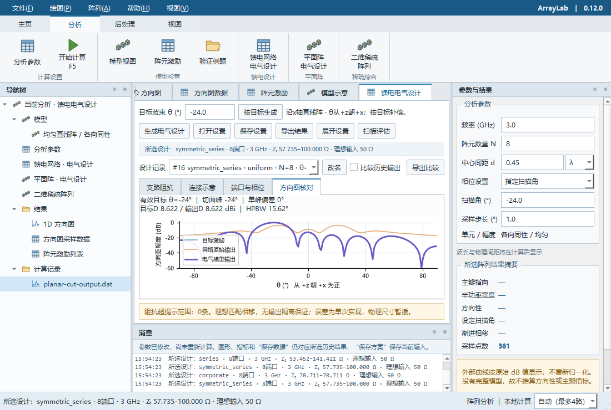

# 多核计算（0.12.0）

工作台右下角可选择“自动（最多4路）”、单核或2–8路并行，作用于之后启动的任务。运行设置不改变阵列参数、随机种子或旧结果，不写入科学配置文件。自动模式对小任务采用串行；实际路数受可用CPU与独立任务数量限制，不保证始终用满所选数量。



| 计算 | 并行粒度 | 保持顺序的部分 |
| --- | --- | --- |
| 多扫描角电气评估 | 各扫描点；按原角度顺序汇总 | 公共阻抗主干、每点相同随机实现、文件输出 |
| 单次平面阵电气设计 | 目标、未经补偿、模型输出三组方向图，最多3路 | 网络综合、界面绘制；此页生成仍等待当前计算结束 |
| 二维稀疏综合/重新复核 | 各布局的全部工况与量化复核 | 贪心、模拟退火、LP及随机数使用顺序 |
| 单个稀疏布局加权 | 一个复核任务，继续串行 | 保持位置，加权与原结果追加语义 |
| 均匀直线阵、单次直线阵馈电、绘图导出 | 继续串行 | 避免为小任务或有状态绘图额外建池 |

自动模式上限为4路且不超过可用逻辑CPU数的一半（最少1路）；少于200万估计阵元采样运算时串行。手动2–8路绕过小任务阈值，仍受可用CPU及任务数限制。该阈值只决定调度，不影响科学精度，未按实时CPU负载动态调节。

并行复核使用有界线程池，共享只读数值输入，每项任务拥有自己的输出。0.22.0.dev1起，桌面稀疏任务整体在一个独立CLI进程内运行，该进程中的方案复核仍使用共享网格的线程池，不为每个方案复制进程。NumPy的许多数值操作会释放GIL，因此这些独立数值任务可利用多核，纯Python顺序算法没有因此变成并行算法。[NumPy线程安全说明](https://numpy.org/doc/stable/reference/thread_safety.html)

每次最多提交与实际路数相同数量的任务。数值批次通过进程内锁协调，运行期间由threadpoolctl将已加载BLAS库限制为单线程，结束或异常时恢复先前值，避免外层任务与内层BLAS线程相乘。稀疏矩阵、搜索、LP/MILP和图形指标也纳入单线程BLAS范围；HiGHS内部固定1线程，MILP保留10秒上限。锁只协调同一进程内的这些批次，不能限制其他进程或外部程序的CPU占用。[threadpoolctl上游说明](https://github.com/joblib/threadpoolctl)

扫描和稀疏页继续在后台运行。扫描取消会停止新增任务，等待当前任务退出；桌面稀疏取消直接终止其独立计算进程，关闭窗口也会先停止并回收资源。Windows使用作业对象保证父程序退出时子进程同时结束。直接调用稀疏Python API仍采用协作取消：在搜索、重加权轮次及原生求解前后检查，不能从回调中中断正在执行的原生LP。失败或取消不发布部分结果，保留已有成功快照。

无头示例：

```powershell
python -m arraylab --headless --study-config examples/scan-linear.json --workers 4 --output-dir results/scan4
python -m arraylab --headless --planar-config examples/planar-rectangular.json --workers 1 --output-dir results/planar1
python -m arraylab --headless --sparse run --config examples/sparse-basic.json --workers 4 --output results/sparse4
python -m arraylab --headless --sparse evaluate --input results/sparse4 --workers 2 --output results/recheck2
```

`--workers 0`为自动（默认），`1`为单路，`2`至`8`为所选上限；其他值拒绝。无头批处理清单中的各作业仍按顺序执行，内部复核使用所选路数。API的`run_study`、`design_planar`、稀疏`run/compute/reevaluate/reweight`接受`workers=`。多个工作线程不共用随机数发生器。

结果中的`execution`记录请求值、实际路数、任务数、线程/串行模式、选择原因、BLAS限制和适用阶段。串并行比较时应排除这段运行信息及已有的耗时字段；数值、布局、端口顺序和随机实现须一致。机器资源设置与科学方案分开，换电脑复算时可重新指定路数。

本机实测和便携包验证见[验证记录](validation.md)。速度收益取决于规模、算例、并发负载和CPU；不保证每个任务都加速。内存数值是同一进程20毫秒采样的工作集峰值，包含界面、缓存和结果，不是独立进程峰值或硬性内存预算。物理尺寸及误差统计继续暂缓。
