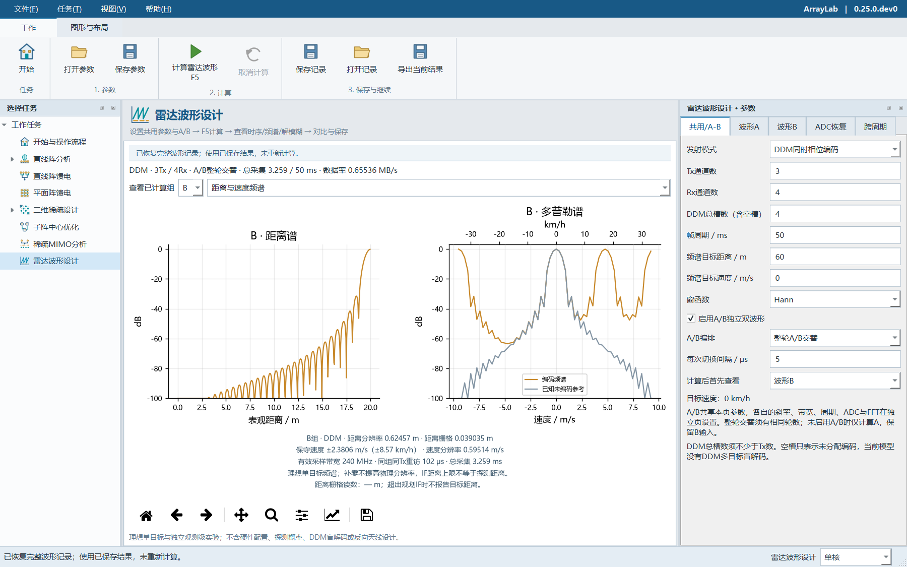

# 雷达波形设计

从ArrayLab开始页“设计雷达波形”、左侧任务树或F11进入。设置参数后按F5计算；进入页面、编辑参数或切换结果视图不会自动计算。此模块从0.25.0.dev0提供，0.23.0正式下载包不含该功能。

本轮采用已完成的WaveLab v1.2固定快照，将波形、A/B和两类距离解模糊能力移入原生Qt界面与Python无头入口。没有打开原Web界面、依赖原服务或修改原工程。原对话新增的稀疏阵列反向设计与天线增益预算不在本轮范围内；ArrayLab原有MIMO模块独立保留。



## 参数与计算顺序

1. 在“共用”页设置TDM/DDM、Tx/Rx数量、DDM槽数、帧周期、目标距离/速度与窗函数。速度同时显示m/s和km/h。
2. 在波形A页设置起始频率、斜率、Ramp、空闲时间、ADC延迟/采样率/点数、IF带宽、FFT长度与慢时间样本数。直接修改整段带宽会反算斜率；修改Chirp周期会保持Ramp并调整空闲时间。
3. 如需双波形，启用A/B，在B页设置另一组独立参数，选择分段或整轮交替及切换间隔。共用参数统一作用于两组；两组独立参数不会互相覆盖。
4. 按F5。先看指标与检查表，再查看Chirp/帧时序、DDM编码、距离/速度谱和距离–速度图。结果页的A/B选择只切换已算结果，不改输入或重新求解。
5. 解模糊实验默认关闭。需使用时分别配置ADC折叠实验或跨周期时延实验，再按F5；图和候选表保留所有解及其状态，多解不会被自动选成一个真值。

界面保留上一份成功结果，输入改变后明确提示尚未计算。失败或取消不覆盖旧结果。后台任务可取消，关闭窗口时先回收任务。

## 指标口径

| 指标 | 使用口径 |
| --- | --- |
| ADC观测时长 | 采样点数 / 采样率 |
| 整段扫频带宽 | 斜率 × Ramp时间 |
| 有效采样带宽 | 斜率 × ADC观测时长 |
| 名义距离分辨率 | c / (2 × 有效采样带宽)，矩形观测孔径基准；加窗会改变主瓣 |
| 距离/速度FFT栅格 | 由FFT长度决定；补零不提高物理分辨率 |
| 波长 | 按ADC观测窗中点频率计算 |
| TDM重访间隔 | 同一Tx再次观测的间隔，包含该轮其他Tx；不能用相邻物理Chirp周期替代 |
| DDM速度范围 | 分开显示原始慢时间范围与保守单槽范围，不声称已完成空槽判别或盲解码 |
| 占空比 | 分开显示任意Tx工作、每路Tx工作及各路占空比之和；DDM总和可超过100% |
| 数据率 | 每个实数ADC样本16 bit，不含协议、填充和处理结果 |

基础关系参考[TI SWRA553](https://www.ti.com/lit/pdf/SWRA553)。本工具延续快照的实数ADC规划假设：可用规划IF取`min(模拟IF带宽, 0.45×采样率)`。0.45是预留采样裕量的模型设定；IF距离上限不等于雷达方程决定的实际探测距离。76–81 GHz是本模型的规划频段，不是器件支持或法规合规证明。

## A/B与DDM

A/B为两组独立上升FMCW profile。分段模式先完成A，再经过切换间隔发B；允许不同循环数。整轮交替以完整A轮、切换、完整B轮、切换组成重复单元，需要两组循环数相等。

设TDM的M=Tx数量、DDM的M=1，物理Chirp周期为Tc,A与Tc,B，切换间隔为g。交替时同组同Tx重访间隔为`M×(Tc,A+Tc,B)+2g`；最后一轮B之后不计额外切换，下一帧切换单独检查帧末空闲余量。两组使用各自的观测带宽和波长，切换/空闲时间不作为信号积累，A/B带宽不直接相加。

DDM图使用深色粗体相位数字与浅色格子。编码按每组自己的Chirp序号推进；DDM频谱中的未编码参考读数使用已知模拟参数，不是多目标盲解码。相关概念参见[MathWorks DDMA示例](https://www.mathworks.com/help/radar/ug/simulate-an-automotive-4d-imaging-mimo-radar.html)。

## 两类距离解模糊

**ADC频率折叠**支持双采样率、双斜率候选一致性。模拟器先生成实余弦IF样本并加窗FFT，求解器仅接收测得的折叠频率、采样/调频参数、模拟IF、外部速度先验与容差，枚举镜像和整数阶候选；不将目标真距离或真拍频传给求解器。模拟前端必须保留相应回波，超出模拟IF时明确不可恢复。错误速度先验可能导致偏差、无解或错误一致解。

**跨Chirp周期归属**采用两次均匀重复周期的时延余数观测，考虑量化误差，求候选区间交集。它是独立的时延观测级实验：假设静止单目标、Tx已正确分离且时延已测得，不是完整FMCW原始回波处理链。该页的实验目标距离独立于主波形目标，远距离示例不表示实际探测能力。

两类实验的第二次采集时间不自动计入主波形帧预算。“唯一”仅在所选搜索范围与容差内成立，候选区间不是统计置信区间。显示状态区分关闭、不可解算、唯一候选、多个候选与无一致候选。

## 保存、对比与导出

- **保存参数**：保存当前输入，格式`arraylab.waveform`；打开后仍需F5。可读取WaveLab schemaVersion 1/2参数，但只导入波形、A/B及解模糊域，不迁移天线布局。
- **加入对比**：最多8个命名的完整结果快照。A/B方案在表中各显示一行，移除任一组会移除该完整方案；当前结果行不作为保存项删除。
- **保存记录**：格式`arraylab.waveform.record`，保存当前已算结果、查看组/视图和对比快照。重启后“打开记录”恢复，不重算频谱或解模糊。此模块没有自动历史数据库，重要对比需手动保存。
- **导出当前结果**：写入全新目录，已有目录不覆盖。含参数、完整记录、JSON、每组距离/多普勒/距离–速度CSV及解模糊JSON。开启A/B时，两组分别导出六类PNG，文件名标注A或B；“保存当前图”则只保存当前显示画面。

示例文件：`waveform-ab-tdm.json`、`waveform-ab-ddm.json`、`waveform-distance-recovery.json`与`waveform-distance-ambiguous.json`。

```powershell
python -m arraylab --headless waveform --config examples/waveform-ab-ddm.json --output-dir results/waveform-ab --plot all
ArrayLab-cli.exe --waveform-config examples/waveform-distance-recovery.json --output-dir results/recovery --plot all
```

运行包不需要Node.js、浏览器或原WaveLab目录。模型不包含噪声、杂波、多径、距离迁移、芯片寄存器、硬件验收、跨A/B相干融合或多目标DDM盲解码。物理尺寸、误差统计以及原对话的新反向设计/增益预算仍不在本轮范围。
