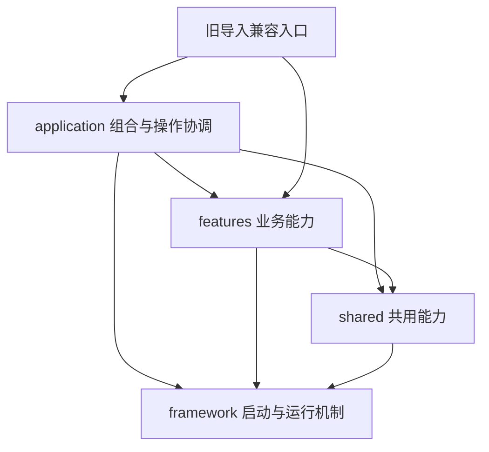

# 结构重构：框架基础层与业务功能模块

本轮以提交`c8749f85c74ded4859ec8f6fd3d3f6776b4e0844`为基线，修改范围是ArrayLab仓库代码。独立的`mbfn_sparse_mimo`、`sparse2d_demo`和`交付`目录未迁移，也未修改其他对话的工程。本机开发版本为0.25.0.dev1；正式Release仍为0.23.0。

## 1. 现有结构问题

- 原`arraylab/`根目录同时放置计算模型、GUI、CLI、记录存储、绘图与运行验收脚本；同一能力需要靠文件名前缀定位。
- 原`__main__.py`同时管理Qt初始化、无头分派和各验收入口；原`cli.py`同时分派全部业务、定义通用JSON输出和馈电选项。
- `window.py`包含线阵参数、计算、曲线和自动历史；`workbench.py`包含线阵表单及结果区。这些是具体业务，不能直接改名成“框架”而保留混杂。
- `feed.write_text_atomic`和线阵配置中的私有JSON函数被其他业务借用；通用`pattern_metrics`包含平面阵专用汇总。
- 延迟导入图存在CLI分派与业务CLI、稀疏场/量化、稀疏导出/控制、子阵计算/绘图四类循环。
- 资源和稀疏子进程cwd依赖实现文件所在层级；直接搬文件会破坏源码、安装包或独立程序。

实际技术栈保留：Python≥3.11，NumPy、SciPy、threadpoolctl；桌面为PySide6与Matplotlib，文件渲染使用Agg，历史使用SQLite/JSON，安装使用setuptools，Windows程序使用PyInstaller。没有Web服务器、中间件链或依赖注入容器，本次也没有添加这些设施或新依赖。

## 2. 目标目录树与职责

```text
arraylab/
  __init__.py / __main__.py / cli.py  # 版本与稳定启动入口
  framework/
    bootstrap.py                    # Qt/无头启动顺序、AppID与环境
    registry.py                     # 通用CLI路由、任务描述与注册机制
    cli_support.py                  # 参数错误与JSON输出协议
    parallel.py                     # 有界并行、取消和BLAS约束
    resources.py / compat.py         # 稳定路径和旧模块转发机制
    tests/
  application/
    bootstrap.py / cli.py            # 具体业务工厂与有序CLI路由
    linear_feed_cli.py               # 原线阵/馈电组合命令的协调
    records.py                      # 多业务记录文件的原格式协调
    desktop/
      window.py / workbench.py       # 窗口与各业务的工作台组装
      workflow.py / task_registry.py # 操作协调与唯一任务元数据表
      history.py / start_page.py
    bridges/mimo.py                 # 跨业务快照交接
    verification/ / tests/
  features/
    linear/    # 线阵模型、参数/记录、自动存储、presenter、表单、绘图
    feed/      # 馈电模型、幅相、支路、图示、桌面及CLI选项、记录
    planar/    # 平面阵模型、指标、CLI、桌面、绘图
    sparse/    # 稀疏桌面/导航/存储/进程/CLI和engine数值引擎
    subarray/  # 子阵模型、优化服务、CLI、桌面、绘图
    studies/   # 扫描评估模型、CLI、对话框、绘图
    mimo/      # MIMO模型、IO、CLI、桌面、绘图
    waveform/  # 波形/A-B/解模糊模型、IO、CLI、桌面、绘图
      __init__.py  # 每个功能的显式、懒加载公开接口
      tests/       # 单元/接口测试就近组织，不进入wheel
      verification/# 原有桌面验收，仍可在独立程序内运行
  shared/
    io.py / history_validation.py    # 原子文本写入、有界数据验证
    numerics/                       # 阵因子、功率积分、角度及工况
    plotting/                       # 通用度量、注记、布局和曲面
    qt/                             # 共用画布和图标
    tests/
  resources/icons/                  # 资产路径保留
  sparse2d/resources/               # 旧资源物理位置保留
  原业务模块名.py                    # 已发布import路径的薄兼容入口
tests/test_*.py                     # 原测试命令的薄转发入口
tools/check_architecture.py         # 边界及静态循环检查
```

`application`是组合根，允许知道具体业务；它不是基础框架。`framework`通过普通函数参数接收窗口、图标和处理器工厂，不导入业务。业务只通过其他功能的公开包入口协作，且使用懒加载避免数值入口提前加载Qt。共用模块仅包含已有多处复用的能力，没有“utils杂项箱”。



业务内部可直接引用本模块文件；跨业务只经公开入口。数据依赖保持有向，例如馈电使用线阵参数，平面阵复用馈电网络，扫描评估使用对应设计结果。扫描对话框由应用工厂创建，馈电模块不反向导入扫描模块。MIMO交接由应用层调用线阵/稀疏的公开快照接口，不读取另一个功能的内部选择控件。

## 3. 分步重构方案与实施顺序

1. **保存基线与审计依赖。** 固定旧提交，识别真实导入环、资源路径和现有测试补丁依赖。
2. **先拆公共工具和codec。** 抽原子IO、严格JSON、线阵与馈电记录校验、通用场函数；分离平面专用指标与稀疏/子阵循环边。
3. **迁移功能目录。** 先按映射搬实现并修正导入；把原Window中的线阵行为和原workbench中的线阵表单就近放入linear。
4. **建立组合与入口。** 框架负责启动/路由机制，应用负责有序业务注册；保留原快捷键、页面/侧栏编号和命令优先级。
5. **保留兼容与测试定位。** 普通旧模块与规范模块指向同一模块对象；拆分的指标旧入口用属性转发。测试实现迁入就近目录，旧pytest路径继续转发，避免重复收集。
6. **验证与构建。** 检查边界、旧接口、记录、代表性CLI等价、资源/子进程以及实际Windows运行包。只运行本次直接受影响的检查，未执行全量算法回归。

## 4. 实际代码修改

- [框架启动](../arraylab/framework/bootstrap.py)在导入Qt前处理无头请求；[应用启动](../arraylab/application/bootstrap.py)提供具体工厂。
- [CLI组合](../arraylab/application/cli.py)保留原首匹配顺序；[任务注册](../arraylab/application/desktop/task_registry.py)集中标题、提示、页面、侧栏与快捷键。原`TASKS`字典仍可读取。
- [线阵presenter](../arraylab/features/linear/presenter.py)接管计算、参数、曲线与自动历史；[线阵layout](../arraylab/features/linear/layout.py)接管原表单与结果视图构造。
- [线阵codec](../arraylab/features/linear/records.py)、[馈电codec](../arraylab/features/feed/records.py)与[应用记录协调](../arraylab/application/records.py)分离，默认预算、JSON字段、SQLite schema及原子操作保持。
- [MIMO桥接](../arraylab/application/bridges/mimo.py)使用公开快照；扫描窗口通过宿主工厂创建，避免业务间双向引用。
- [资源定位](../arraylab/framework/resources.py)不再依赖业务文件层级；图标、稀疏手册和CSV仍在既有包资源位置，用户数据环境变量和AppData路径不变。
- `pyproject.toml`继续使用setuptools，明确排除就近单元测试包；`ArrayLab.spec`同步规范GUI排除与旧模块显式收集，保留CLI无需Qt运行的边界。
- 新增[架构检查](../tools/check_architecture.py)，覆盖静态和函数内导入、字面量动态导入及明确模块别名的私有访问。测试/桌面验收代码可依赖组合层，不计作运行层反向依赖。

### 兼容性说明

- 原`arraylab`/`arraylab-cli`命令、`python -m arraylab`、既有业务CLI入口、F键、参数/结果格式、持久化目录和资源位置保留。101个已发布模块路径留有兼容入口。
- 旧import不是复制一份函数名字；普通模块共享对象，旧补丁与规范模块能看到同一状态。原混合指标模块拆分后，正常属性访问、星号导入及补丁转发仍可用。
- Python实现的反射路径（例如类/函数的`__module__`、源码文件位置）会指向规范目录；这是搬迁的必要结果。没有声称未知第三方对私有全局变量、`module.__dict__`或自定义pickle的依赖已经验证。项目现有支持的JSON/SQLite持久化不依赖这些反射路径。
- 一处测试预算故障注入改到实际拥有预算的线阵codec；默认64 MiB未变，直接调用旧记录字节接口仍遵循其原预算。
- 版本标识更新为0.25.0.dev1用于区分本机运行包，属于预期元数据变化；本轮没有新增业务功能。

## 5. 验证结果

| 检查 | 实际结果 |
| --- | --- |
| 依赖边界与循环 | 222个模块、442条边，0边界违规、0静态循环，包含延迟导入；`tmp/refactor-architecture-final.json` |
| 迁移后定向测试 | 369项通过、2项未选择，29.68秒；覆盖框架/路由、兼容导入、配置/codec/存储及稀疏子进程；`tmp/refactor-selected/pytest.log` |
| 快照接口补充 | 3项通过：数组副本归接收方所有、源业务保留单元类型、MIMO目标限制由应用桥接执行 |
| 测试位置 | 原`tests`路径最终收集1300项，没有执行全量；与干净基线比较未丢失原测试；`tmp/refactor-collection-final/report.json` |
| 基线业务等价 | 11/11通过：10个CLI代表及真实稀疏子进程，106个输出文件比较；`tmp/refactor-equivalence/report.json` |
| 历史字节等价 | 抽离codec阶段6项旧HEAD字节/恢复比较通过，包含三种馈电、线阵与NumPy扩展；`tmp/refactor-history-codecs/byte-equivalence.json` |
| 源码GUI交接 | MIMO专项通过，包含线阵/稀疏公开快照交接；`tmp/refactor-mimo-source/smoke.json` |
| 安装包 | wheel构建通过，单元测试未进入wheel，资源存在；隔离解压后原无头线阵入口通过 |
| 打包后专项 | 波形41项Qt和10项CLI、MIMO42项Qt、稀疏85项Qt通过；`tmp/refactor-frozen-final`；末次快照边界调整后最终包再通过MIMO42项，`tmp/refactor-frozen-delivery` |
| 最终包完整性 | 249个运行模块（含兼容入口）与源码一致；CLI的PYZ中无PySide6，wheel中无单元测试包；`tmp/refactor-frozen-delivery/integrity.json` |

基线比较只排除应用版本、生成时刻、运行耗时和输出绝对目录；物理Chirp/观测时间、参数、schema_version和数值结果均参与比较。JSON数值容差为相对1e-11、绝对1e-10；CSV/DAT/SVG按字节比较。

首次打包检查发现旧兼容模块未被自动收集，已补显式hiddenimports并重新构建、通过上述独立程序检查。首次CLI帮助读取还暴露了Windows帮助文本的既有本地编码；改为捕获字节并识别UTF-8/GB18030，未改变程序原输出协议。失败记录保留，不计入通过结果。

测试收集对比时，干净基线没有本机被忽略的旧发行验收目录，3个可选历史材料用例显示`[None]`占位；当前目录有对应材料。只对这3个用例按函数名归一，其余固定参数化ID逐项比较。1300项为收集数量，不是通过数量。最后的公开快照调整只重跑了其直接影响路径，没有重复其他业务专项。

本轮没有执行全部业务数值测试、父进程异常死亡/原生内存限额两项OS级用例、其他操作系统或干净机器验收。当前证据限于本机Windows 10、隔离数据目录和所列路径。所有程序验证在源码推送前完成，推送后只核对交付状态。
